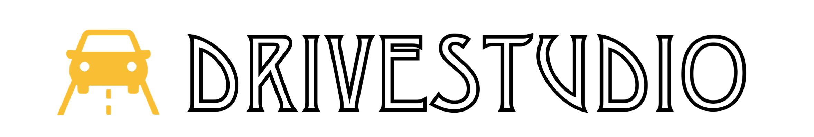

<a id="top"></a>

<p align="center">
  <picture>
    <source media="(prefers-color-scheme: dark)" srcset="docs/media/logo-dark.png">
    <source media="(prefers-color-scheme: light)" srcset="docs/media/logo.png">
    
  </picture>
</p>

# drive2sim

[Tiếng Việt: README_VN.md](README_VN.md)

drive2sim turns recorded driving data (camera images, LiDAR, poses) into a 3D Gaussian Splatting scene that you can view, measure and export. It wraps the reconstruction methods of [DriveStudio](https://github.com/ziyc/drivestudio) (OmniRe, Street Gaussians) in one tool: a `d2s` command line and a local web app called Studio. You pick a dataset, a scene and a method, and the tool runs every step for you, on your own GPU or on Kaggle and Google Colab. It is meant for people who want to compare reconstruction methods on the same scene without writing training scripts.

## Table of Contents

- [Key Features](#key-features)
- [Repository Structure](#repository-structure)
- [Requirements](#requirements)
- [Getting Started](#getting-started)
- [Documentation](#documentation)
- [Contributing](#contributing)
- [Acknowledgement](#acknowledgement)
- [License](#license)

## Key Features

- **One path from raw data to a result.** Ingest a scene, choose which frames are held out for testing, train, evaluate (PSNR, SSIM, LPIPS) and export a standard `.ply`, with one command per step or a few clicks in Studio.
- **Several methods on the same scene.** OmniRe (background, vehicles and people), Street Gaussians (background and vehicles) and a static-scene 3DGUT trainer, with three renderers: standard 3DGS, 3DGUT and 3DGEER.
- **Pinhole and fisheye cameras.** KITTI-360 fisheye cameras are converted to the OpenCV fisheye model and trained together with the pinhole cameras.
- **Optional speed-ups**, each one a switch: FastGS-style densification (fewer Gaussians), Faster-GS kernels, MCMC densification, and reuse of masks and human poses between runs.
- **Run anywhere.** The same run executes locally, on a Kaggle GPU or on a Colab VM; the tool sends it, follows it and downloads the result.
- **Studio** shows every run with its stage timeline, a comparison table across runs and a 3D viewer that plays the scene over time.

Results on nuScenes `scene-0061`, three front cameras, 30k steps, one Tesla T4:

| Method | Renderer | Test PSNR | Training time | Peak VRAM |
|---|---|---|---|---|
| OmniRe + FastGS + Faster-GS | 3DGS | 25.01 | 2 h 29 min | 4.7 GB |
| Street Gaussians + FastGS | 3DGS | 25.02 | 1 h 11 min | 3.4 GB |
| OmniRe | 3DGUT | 23.99 | 2 h 26 min | 3.5 GB |
| OmniRe | 3DGEER | 21.77 | 2 h 43 min | 4.3 GB |

Each number comes from one run on one scene. The full list, with the settings of each run, is in [docs/experiments/run_plan.md](docs/experiments/run_plan.md).

## Repository Structure

| Path | Content |
|---|---|
| `drive2sim/` | The tool: CLI (`cli/`), run engine (`engine/`), dataset converters (`ingest/`), pipeline steps (`stages/`), methods (`approaches/`), Studio (`studio/`) |
| `drive2sim/recon/` | The DriveStudio reconstruction code that the pipeline steps call |
| `envs/` | Install scripts for the GPU environment |
| `third_party/` | gsplat-geer (renderers), SMPL and 4D-Humans code |
| `docs/` | Design, file formats, dataset guides and method notes |
| `tests/` | Tests (`make test`) |

## Requirements

- Training needs Linux, an NVIDIA GPU and the CUDA toolkit (`nvcc`), because the renderers are compiled during install. The runs above used at most 5 GB of GPU memory.
- Without a GPU you can still use Studio and the CLI, and send runs to Kaggle or Colab. This light setup needs [uv](https://docs.astral.sh/uv/) and Node.js.
- OmniRe reconstructs people with the SMPL body model. Its file `SMPL_NEUTRAL.pkl` has its own licence and is not in the repository. Download it from [smpl.is.tue.mpg.de](https://smpl.is.tue.mpg.de) and put it at `<workdir>/smpl_models/SMPL_NEUTRAL.pkl`.

## Getting Started

This path uses nuScenes v1.0-mini, a free sample of about 4 GB from [nuscenes.org](https://www.nuscenes.org/download) (registration needed).

1. **Clone the repository.**

   ```bash
   git clone --recursive --branch drive2sim https://github.com/Octoopass/drivestudio_plus.git
   cd drivestudio_plus
   ```

2. **Install.** On a machine with an NVIDIA GPU:

   ```bash
   conda env create -f envs/main.yml
   conda activate drive2sim
   bash envs/install_main.sh        # if a step fails, fix it and rerun: bash envs/install_main.sh --from <step>
   ```

   On a machine without a GPU, `make setup` creates `.venv/` with only the CLI and Studio (use `.venv/bin/d2s`).

3. **Ingest a scene.** The tool works in a working directory that holds `data/`, `cache/` and `runs/`. It is the folder in `D2S_WORKDIR`, or the current folder.

   ```bash
   d2s source inspect /path/to/nuscenes      # shows what the tool recognises in the folder
   d2s scene ingest /path/to/nuscenes --version v1.0-mini --sequence scene-0061
   d2s split create <scene_id> --strategy every_nth_frame:8
   ```

   `scene ingest` prints the `scene_id`, and `split create` prints the `split_id` used in the next step.

4. **Train.**

   ```bash
   d2s run start omnire --scene <scene_id> --split <split_id>                     # on this machine
   d2s run start omnire --scene <scene_id> --split <split_id> --executor kaggle   # on Kaggle
   ```

   `d2s approach list` shows the methods, and `d2s approach show <method>` their options. Kaggle needs a Kaggle API token and the SMPL file uploaded as a private dataset ([CONTRACTS section 9.2](docs/drive2sim/CONTRACTS.md)).

5. **Look at the result.** `d2s report` prints the metrics of every run. To see more, start Studio and open the address it prints:

   ```bash
   make studio            # or: d2s studio
   ```

   Steps 3 and 4 can also be done in Studio, on the Scenes and New run pages.

## Documentation

| Document | What it covers |
|---|---|
| [docs/drive2sim/SPEC.md](docs/drive2sim/SPEC.md) | What the tool does, step by step, as a user sees it |
| [docs/drive2sim/ARCHITECTURE.md](docs/drive2sim/ARCHITECTURE.md) | How the tool is built and why |
| [docs/drive2sim/CONTRACTS.md](docs/drive2sim/CONTRACTS.md) | File formats, CLI, API, Kaggle and Colab details |
| [docs/datasets/overview.md](docs/datasets/overview.md) | Camera layout of each dataset, with one download and ingest guide per dataset |
| [docs/methods/](docs/methods/) | One page per method or speed-up: what it does and how it differs from the paper |
| [docs/drivestudio.md](docs/drivestudio.md) | Calling the DriveStudio scripts directly, without the tool |

Supported datasets: nuScenes, Waymo, Argoverse 2, PandaSet, nuPlan, KITTI, KITTI-360 and PhysicalAI. nuScenes has been trained end to end. KITTI-360 ingest has been checked on real data, and training on it is the next step. The other datasets use DriveStudio's converters and loaders, but no training run has been made with them in this project yet.

## Contributing

Read [AGENTS.md](AGENTS.md) first. It holds the coding rules, the test commands and the rule that docs change together with the code. Run `make check` (format, lint, tests) before each commit. Report problems in the repository's Issues.

## Acknowledgement

The reconstruction code comes from [DriveStudio](https://github.com/ziyc/drivestudio) and its OmniRe paper. The 3DGUT and 3DGEER renderers come from Bosch Research's [3DGEER patch](https://github.com/boschresearch/3dgeer) of [gsplat](https://github.com/nerfstudio-project/gsplat). The speed-ups follow [FastGS](https://github.com/fastgs/FastGS), [Faster-GS](https://github.com/nerficg-project/faster-gaussian-splatting) and [3DGS-MCMC](https://github.com/ubc-vision/3dgs-mcmc); every difference from the original is listed in [docs/methods/](docs/methods/). If you use this code, please cite OmniRe:

```bibtex
@inproceedings{chen2025omnire,
  title={OmniRe: Omni Urban Scene Reconstruction},
  author={Ziyu Chen and Jiawei Yang and Jiahui Huang and Riccardo de Lutio and Janick Martinez Esturo and Boris Ivanovic and Or Litany and Zan Gojcic and Sanja Fidler and Marco Pavone and Li Song and Yue Wang},
  booktitle={The Thirteenth International Conference on Learning Representations},
  year={2025}
}
```

## License

DriveStudio is under the MIT licence ([LICENSE](LICENSE)). The Bosch 3DGEER patch included here is under AGPL-3.0, so the repository as a whole has to follow the AGPL-3.0 terms. Check them before you redistribute it or offer it as a service. Datasets and the SMPL model keep their own licences; KITTI-360, for example, is for non-commercial use only.

[Back to Top](#top)
