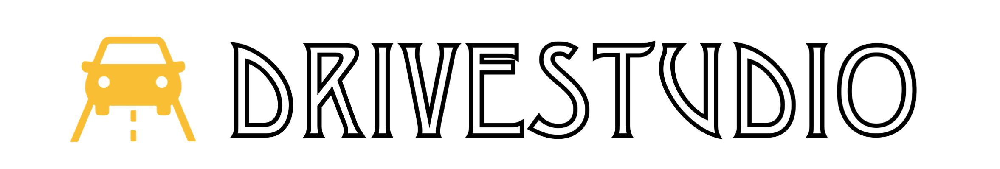

<a id="top"></a>

<p align="center">
  <picture>
    <source media="(prefers-color-scheme: dark)" srcset="docs/media/logo-dark.png">
    <source media="(prefers-color-scheme: light)" srcset="docs/media/logo.png">
    
  </picture>
</p>

# drive2sim

[English: README.md](README.md)

drive2sim dựng lại một đoạn đường thành cảnh 3D từ ảnh camera, các điểm đo LiDAR và thông tin vị trí, hướng của cảm biến khi ghi dữ liệu. Bạn có thể xem cảnh từ góc nhìn khác, xem xe và người chuyển động theo thời gian, rồi so sánh chất lượng và thời gian dựng cảnh giữa các cấu hình.

Cảnh được biểu diễn bằng **3D Gaussian Splatting**: nhiều phần tử 3D nhỏ, mỗi phần tử có vị trí, kích thước, màu và mức độ trong suốt. Khi cần một bức ảnh, phần mềm chiếu và ghép các phần tử này theo góc nhìn camera. Quá trình **huấn luyện**, hay *train*, điều chỉnh các tham số của cảnh sao cho ảnh tạo ra gần với ảnh đã ghi.

drive2sim dùng mã tái dựng của [DriveStudio](https://github.com/ziyc/drivestudio), bổ sung lệnh `d2s` và giao diện web **Studio** chạy trên máy của bạn. Tool giúp chuẩn bị dữ liệu, chạy huấn luyện, đánh giá và lưu kết quả theo cùng một cấu trúc, để bạn thử nhiều cấu hình mà không phải tự nối các script.

## Mục lục

- [Một lần chạy gồm những gì?](#một-lần-chạy-gồm-những-gì)
- [Chọn phương pháp và renderer](#chọn-phương-pháp-và-renderer)
- [Dùng chung camera pinhole và mắt cá](#dùng-chung-camera-pinhole-và-mắt-cá)
- [Cài đặt và bắt đầu sử dụng](#cài-đặt-và-bắt-đầu-sử-dụng)
- [Kết quả đã có và phạm vi đã kiểm chứng](#kết-quả-đã-có-và-phạm-vi-đã-kiểm-chứng)
- [Chuyển kết quả sang máy khác](#chuyển-kết-quả-sang-máy-khác)
- [Tài liệu và mã nguồn](#tài-liệu-và-mã-nguồn)
- [Đóng góp](#đóng-góp)
- [Lời cảm ơn](#lời-cảm-ơn)
- [Bản quyền](#bản-quyền)

## Một lần chạy gồm những gì?

Một **dataset** là bộ dữ liệu đã ghi, chẳng hạn nuScenes hoặc KITTI-360. Bạn chọn một đoạn ghi hình trong đó để tạo **cảnh** (*scene*). Cảnh chứa ảnh, điểm LiDAR, thông số camera và dữ liệu mô tả xe, người nếu nguồn có cung cấp.

Trước khi huấn luyện, bạn tạo một **split**: chọn camera nào, đoạn khung hình nào, và ảnh nào dùng để học hoặc để kiểm tra. Ví dụ, bạn có thể chọn ba camera phía trước và giữ lại một khung trong mỗi mười khung để kiểm tra. Ảnh kiểm tra không được dùng để cập nhật mô hình.

Một **run** là một lần thực nghiệm với một cảnh, một split và một bộ cấu hình cụ thể. Run thường đi qua các bước:

1. Chuẩn bị dữ liệu cần cho phương pháp, chẳng hạn đánh dấu vùng trời, vùng vật thể chuyển động và ước lượng tư thế người.
2. Huấn luyện mô hình cảnh từ các ảnh thuộc phần dùng để học.
3. So ảnh mô hình tạo ra với ảnh đã giữ lại để kiểm tra, rồi ghi các chỉ số như PSNR, SSIM và LPIPS.
4. Lưu checkpoint, ảnh, video và các bản xuất 3D. **Checkpoint** là file chứa tham số của mô hình đã học, để nạp lại mô hình mà không phải học từ đầu.

Mọi dữ liệu nằm trong một **thư mục làm việc** (*workdir*) do bạn chọn. `data/` chứa các cảnh đã nạp, `runs/` chứa kết quả từng run, còn `cache/` giữ kết quả chuẩn bị có thể dùng lại. Chẳng hạn, hai run dùng cùng cảnh và cùng cách tạo mask có thể dùng chung kết quả đó, thay vì tính lại từ đầu. Mask là ảnh đánh dấu những vùng cần xử lý theo cách riêng, như trời hoặc vật thể chuyển động.

## Chọn phương pháp và renderer

**Phương pháp tái dựng** quyết định cảnh được chia và mô hình hoá như thế nào. **Renderer** là bộ phận tạo ảnh từ mô hình cảnh theo thông số camera; nó được dùng cả khi huấn luyện lẫn khi xem lại kết quả. Vì vậy, chọn OmniRe và chọn 3DGUT là hai lựa chọn ở hai khâu khác nhau. Tên 3D Gaussian Splatting chỉ cách biểu diễn cảnh bằng Gaussian; còn `renderer=3dgs` là tên bộ vẽ gốc. Chọn 3DGUT hoặc 3DGEER vẫn dùng cảnh được biểu diễn bằng Gaussian 3D.

| Lựa chọn | Vai trò trong tool |
|---|---|
| **OmniRe** | Mô hình hoá nền, xe, người và vật thể biến dạng bằng các thành phần riêng trong cùng cảnh. Người được mô hình hoá bằng SMPL, một mô hình cơ thể có khớp để biểu diễn tư thế. |
| **Street Gaussians** (`streetgs`) | Mô hình hoá nền và xe; không có thành phần người SMPL của OmniRe. |
| **3DGS** (`3dgs`) | Renderer dùng cho camera pinhole, tức mô hình chiếu phối cảnh thông thường. |
| **3DGUT** (`3dgut`) và **3DGEER** (`3dgeer`) | Các renderer có thể làm việc với camera pinhole và các mô hình camera góc rộng mà tool hỗ trợ. |

Tool còn có các tuỳ chọn về tốc độ và cách thêm, bớt Gaussian khi học. **FastGS** điều chỉnh việc thêm và loại Gaussian. **Faster-GS** tối ưu một số phép tính trong quá trình huấn luyện; phần tối ưu thực sự được dùng phụ thuộc renderer. Cách densify MCMC đã được thử rồi gỡ khỏi lựa chọn vì kém hơn quy tắc gốc ([docs/methods/densify_mcmc.md](docs/methods/densify_mcmc.md)). Chạy `d2s approach show omnire` để xem các lựa chọn; `d2s approach check` kiểm tra cấu hình trước khi tạo run. Chi tiết từng cách nằm trong [docs/methods/](docs/methods/).

## Dùng chung camera pinhole và mắt cá

Với KITTI-360, bạn có thể chọn **hai camera pinhole và hai camera mắt cá trong cùng một run**. Ảnh từ cả bốn camera cùng được dùng để huấn luyện **một mô hình cảnh dùng chung**. Trong quá trình học, tool lấy ảnh từ tập huấn luyện, tạo ảnh dự đoán từ mô hình cảnh theo camera tương ứng, rồi dùng sai khác giữa hai ảnh để cập nhật mô hình. Mỗi camera vẫn giữ thông số ống kính và vị trí riêng.

Khi render theo camera fisheye, ảnh dự đoán cũng có độ cong mắt cá để so được với ảnh chụp từ ống kính đó. Với cùng cảnh 3D, render theo camera pinhole sẽ tạo ảnh phối cảnh thông thường. Ví dụ, một cột đèn thẳng trong không gian có thể hiện cong ở rìa ảnh fisheye, trong khi ảnh pinhole biểu diễn đường thẳng đó theo phép chiếu phối cảnh. Độ méo của ống kính được mô tả ở phép chiếu từ 3D ra ảnh; mục tiêu không phải uốn hình học cảnh theo hình dạng cong của ảnh fisheye.

Khi mở kết quả, viewer hiển thị một khung nhìn qua camera ảo. Hai loại camera đầu vào không tự tạo hai màn hình hay hai cảnh. Bản xem trước trong trình duyệt hiện dùng camera pinhole; các lựa chọn khác phụ thuộc viewer và renderer đang dùng. Camera dùng để xem lại không bắt buộc cùng loại với camera đã cung cấp ảnh huấn luyện.

Ảnh mắt cá giữ phép chiếu và độ cong của ảnh gốc, dù có thể được giảm độ phân giải theo cấu hình. Khi nạp KITTI-360, tool khớp các thông số ống kính gốc, được mô tả bằng mô hình Mei, sang cách biểu diễn **OpenCV fisheye** mà renderer đọc được. Đây là chuyển đổi **thông số mô hình camera**, không phải nắn ảnh mắt cá thành ảnh pinhole. Khi dựng ảnh dự đoán, renderer dùng mô hình camera tương ứng để xử lý độ méo của ống kính. Phép chuyển này giữ nguyên góc nhìn: mô hình đã khớp lệch mô hình Mei dưới 0,5 px tới mép trái, phải của ảnh (khoảng 96° lệch trục, khoảng 191° theo chiều ngang). Khi train, tool che vùng thân xe ghi dữ liệu, vùng đen ngoài hình tròn ống kính (dò từ ảnh) và phần mà mô hình đã khớp lệch Mei quá 0,5 px (tính từ calib của từng camera: 96° lệch trục với `image_02`, 92,5° với `image_03`). Với cả 3DGUT và 3DGEER thì che thêm phần lệch trục quá 88°, vì gsplat bỏ Gaussian có tâm sau mặt phẳng camera nên không vẽ được gì từ 90° trở ra ([docs/datasets/kitti360_fisheye_workflow.md](docs/datasets/kitti360_fisheye_workflow.md)).

Bạn chọn nhóm ảnh đưa vào một run thông qua split:

| Camera được chọn trong split KITTI-360 | Dữ liệu dùng để học trong run đó |
|---|---|
| `image_00`, `image_01` | Chỉ ảnh từ hai camera pinhole. |
| `image_02`, `image_03` | Chỉ ảnh từ hai camera mắt cá. |
| Cả bốn camera | Ảnh pinhole và mắt cá cùng cập nhật mô hình cảnh của run. |

Run có ảnh mắt cá cần chọn `renderer=3dgut` hoặc `renderer=3dgeer`; lựa chọn `3dgs` hiện chỉ nhận pinhole. Nếu muốn so sánh ba nhóm camera trên, bạn tạo ba split và chạy ba run riêng, mỗi run học một mô hình cảnh của nó.

**Mức kiểm chứng hiện tại:** code nạp dữ liệu, thông số camera và phép chiếu KITTI-360 đã được kiểm tra trên dữ liệu thật. Ba thực nghiệm OmniRe gồm chỉ pinhole, chỉ fisheye và kết hợp cả hai chưa hoàn tất. Do đó, README mô tả khả năng dùng chung trong code; chưa có kết quả thực nghiệm để kết luận thêm ảnh mắt cá cải thiện chất lượng bao nhiêu. Xem [hướng dẫn KITTI-360](docs/datasets/kitti360.md) và [kế hoạch thực nghiệm](docs/experiments/run_plan.md).

## Cài đặt và bắt đầu sử dụng

**Một lệnh.** `npx github:thaianh20021/drive2sim` (Node.js 18+) tải mã nguồn và cài mọi thứ vào
`~/.drive2sim`; `npx github:thaianh20021/drive2sim start` bật Studio ở nền trên máy chủ không màn
hình. Không có Node.js: `bash envs/install.sh` (Linux, macOS) hoặc
`powershell -ExecutionPolicy Bypass -File envs\install.ps1` (Windows). Linux có GPU NVIDIA được cài
đủ môi trường train; macOS, Windows và Linux không GPU cài Studio + CLI, chạy run trên Kaggle hoặc
Colab. Chi tiết: [docs/install.md](docs/install.md); gói cài cho từng hệ điều hành ở trang
[Releases](https://github.com/thaianh20021/drive2sim/releases). Các bước cài tay bên dưới vẫn dùng được.

**Gói cài (v0.3.0).** Tải gói cho hệ điều hành của bạn ở trang
[Releases](https://github.com/thaianh20021/drive2sim/releases/tag/v0.3.0), giải nén rồi chạy bộ
cài bên trong. Không cần git.

| Hệ điều hành | Gói | Cài |
|---|---|---|
| Linux | [drive2sim-v0.3.0-linux.tar.gz](https://github.com/thaianh20021/drive2sim/releases/download/v0.3.0/drive2sim-v0.3.0-linux.tar.gz) (57 MB, kèm submodule) | `tar -xzf drive2sim-v0.3.0-linux.tar.gz && bash drive2sim-v0.3.0/envs/install.sh` |
| macOS | [drive2sim-v0.3.0-macos.tar.gz](https://github.com/thaianh20021/drive2sim/releases/download/v0.3.0/drive2sim-v0.3.0-macos.tar.gz) (4 MB) | `tar -xzf drive2sim-v0.3.0-macos.tar.gz && bash drive2sim-v0.3.0/envs/install.sh` |
| Windows | [drive2sim-v0.3.0-windows.zip](https://github.com/thaianh20021/drive2sim/releases/download/v0.3.0/drive2sim-v0.3.0-windows.zip) (4,5 MB) | Giải nén, rồi trong PowerShell: `powershell -ExecutionPolicy Bypass -File drive2sim-v0.3.0\envs\install.ps1` |

Mã kiểm tra: [SHA256SUMS.txt](https://github.com/thaianh20021/drive2sim/releases/download/v0.3.0/SHA256SUMS.txt). Cài xong bật Studio bằng `drive2sim-studio`
rồi mở <http://127.0.0.1:8765>.

Tải mã nguồn trước. Các lệnh bên dưới được chạy từ thư mục `drive2sim` vừa tải:

```bash
git clone --recursive https://github.com/thaianh20021/drive2sim.git
cd drive2sim
```

Sau đó chọn cách dùng phù hợp: mở một gói kết quả đã có, hoặc tự dựng cảnh từ dữ liệu gốc. Trong ví dụ, `../drive2sim-workdir` là thư mục dữ liệu nằm cạnh thư mục mã nguồn; bạn có thể đổi sang đường dẫn khác.

### Mở gói kết quả đã có

Nếu bạn đã nhận một file `.tar` do `d2s pack` tạo, bạn có thể xem metric, ảnh, video và bản xem 3D trong trình duyệt bằng môi trường nhẹ. Cách cài từ mã nguồn này cần Python 3.9 trở lên, [uv](https://docs.astral.sh/uv/) và Node.js:

```bash
make setup
mkdir ../drive2sim-workdir
tar -xf /duong/dan/results.tar -C ../drive2sim-workdir
make studio WORKDIR=../drive2sim-workdir
```

Thay `/duong/dan/results.tar` bằng file bạn nhận và dùng một thư mục giải nén trống. Mở địa chỉ mà Studio in ra. Cách xem này không yêu cầu GPU NVIDIA trên máy bạn. Muốn render bằng renderer của mô hình, xuất lại hoặc huấn luyện trên máy, cần môi trường GPU ở phần tiếp theo.

### Tự dựng một cảnh từ dữ liệu gốc

Đường chạy local hiện dùng Linux, GPU NVIDIA và CUDA toolkit có lệnh `nvcc`. Cần [Conda](https://docs.conda.io/) để tạo môi trường Python theo cấu hình của dự án:

```bash
conda env create -f envs/main.yml
conda activate drive2sim
bash envs/install_main.sh
```

Script cài các thư viện cần cho dựng cảnh và biên dịch các thành phần GPU. Nếu một bước lỗi, sửa nguyên nhân rồi dùng `bash envs/install_main.sh --from <buoc>` để chạy tiếp từ bước đó; tên các bước có trong script. Cách cài nhẹ `make setup` không cài các thư viện này.

Ví dụ sau dùng **nuScenes v1.0-mini**. Tải dữ liệu từ [nuscenes.org](https://www.nuscenes.org/download) sau khi đăng ký tài khoản, rồi giải nén để thư mục nguồn có các thư mục `v1.0-mini/`, `samples/` và `sweeps/`. Phần `sweeps/` chứa ảnh và LiDAR giữa các khung được gán nhãn chính; cách nạp mặc định cần phần này để tạo chuỗi dày hơn theo thời gian.

Tạo thư mục làm việc, kiểm tra nguồn rồi nạp riêng chuỗi `scene-0061`:

```bash
mkdir -p ../drive2sim-workdir
d2s source inspect /duong/dan/nuscenes
d2s scene ingest /duong/dan/nuscenes --version v1.0-mini --sequence scene-0061 \
  --workdir ../drive2sim-workdir
```

Thay `/duong/dan/nuscenes` bằng thư mục nguồn vừa giải nén. Lệnh nạp tạo cảnh có tên `nuscenes_scene-0061` trong thư mục làm việc. Sau đó tạo split tên `front3`, chọn ba camera phía trước và dành một khung trong mỗi mười khung để kiểm tra:

```bash
d2s split create nuscenes_scene-0061 --split front3 \
  --cameras CAM_FRONT,CAM_FRONT_LEFT,CAM_FRONT_RIGHT --strategy every_nth_frame:10 \
  --workdir ../drive2sim-workdir
```

OmniRe cần file mô hình cơ thể `SMPL_NEUTRAL.pkl` để dựng người. Nếu thư mục làm việc chưa có file `smpl_models/SMPL_NEUTRAL.pkl`, lấy file từ [SMPL](https://smpl.is.tue.mpg.de) hoặc từ gói kết quả được cung cấp và đặt đúng chỗ đó. File này không nằm trong mã nguồn Git; gói bàn giao tạo bằng `d2s pack` có kèm nó khi run cần SMPL.

Bắt đầu một run OmniRe với cấu hình mặc định:

```bash
d2s run start omnire --scene nuscenes_scene-0061 --split front3 \
  --workdir ../drive2sim-workdir
```

Lệnh in ra một mã `run_id` để nhận diện lần thực nghiệm. Run đầu có thể cần tải trọng số và tính các bước chuẩn bị; run sau chỉ dùng lại kết quả chuẩn bị khi đầu vào và cấu hình tương ứng khớp nhau. Để xem bảng kết quả hoặc mở Studio bằng môi trường GPU vừa cài:

```bash
d2s report --workdir ../drive2sim-workdir
make studio CONDA_ENV=drive2sim WORKDIR=../drive2sim-workdir
```

Các bước nạp cảnh, tạo split và tạo run cũng có trong Studio. Nếu muốn tạo **run mới trên Kaggle**, thêm `--executor kaggle` vào lệnh `run start`; Colab dùng `--executor colab`. Hai nơi chạy này cần thiết lập đăng nhập và dữ liệu riêng trước. Hướng dẫn [Kaggle](docs/drive2sim/CONTRACTS.md#92-gói-job-cho-kaggle) và [Colab](docs/drive2sim/CONTRACTS.md#93-chạy-trên-colab) mô tả các bước đó, gồm cách cung cấp SMPL cho run cần người.

## Kết quả đã có và phạm vi đã kiểm chứng

Các dòng sau đều dùng nuScenes `scene-0061`, ba camera phía trước, 30.000 bước huấn luyện, ảnh 800×450 và một GPU Tesla T4. Những tuỳ chọn ở cột cấu hình là một phần của thực nghiệm, nên không xem bảng này là phép so sánh chỉ thay riêng renderer.

| Run | Phương pháp | Renderer | Cấu hình thêm | PSNR tập kiểm tra | Thời gian train | VRAM đỉnh (MiB) |
|---|---|---|---|---|---|---|
| `f8a6` | OmniRe | 3DGS | FastGS, Faster-GS | 25,01 | 2 giờ 29 phút | 4727 |
| `ccec` | Street Gaussians | 3DGS | FastGS | 25,02 | 1 giờ 11 phút | 3381 |
| `60e5` | OmniRe | 3DGUT | FastGS, Faster-GS | 23,99 | 2 giờ 26 phút | 3463 |
| `a8a9` | OmniRe | 3DGEER | FastGS, Faster-GS, thêm/bớt Gaussian mỗi 50 bước | 21,77 | 2 giờ 43 phút | 4257 |

PSNR đo mức khớp giữa ảnh render và ảnh kiểm tra; giá trị cao hơn là tốt hơn khi so trên cùng tập ảnh. VRAM là bộ nhớ GPU, ở đây ghi theo MiB (1024 MiB = 1 GiB). Dung lượng cần cho cảnh khác còn phụ thuộc số ảnh, độ phân giải và cấu hình. Mỗi dòng là một lần chạy; danh sách đầy đủ và các giới hạn so sánh nằm trong [run_plan.md](docs/experiments/run_plan.md).

nuScenes đã chạy trọn đường từ dữ liệu tới kết quả. KITTI-360 đã được kiểm tra phần nạp và hình học camera, còn các run OmniRe đối chứng nói trên đang chờ thực nghiệm. Waymo, Argoverse 2, PandaSet, nuPlan, KITTI và PhysicalAI có đường nạp/đọc dựa trên DriveStudio nhưng chưa được dự án này kiểm chứng bằng train end-to-end trên dữ liệu thật. Kaggle đã có run hoàn tất; tích hợp Colab hiện chưa được kiểm chứng bằng một run GPU thật.

Khi xem kết quả, cần phân biệt các bản xuất. GPU viewer dùng checkpoint và renderer của mô hình. Bản xem trong trình duyệt dùng dữ liệu đã xuất để xem trên máy không có môi trường CUDA. File `.ply` là bản xuất tĩnh gồm nền và, nếu chọn, xe ở một khung; nó không chứa đầy đủ chuyển động và người SMPL như hai cách xem trên.

## Chuyển kết quả sang máy khác

`d2s pack` gom các run bạn chọn, cảnh đã nạp, kết quả chuẩn bị được tham chiếu và mọi checkpoint. Nếu run cần mô hình SMPL, lệnh cũng chép mô hình vào `smpl_models/SMPL_NEUTRAL.pkl` trong gói. Người nhận giải nén là có dữ liệu để mở các run, còn môi trường chạy phần mềm vẫn cần cài theo hướng dẫn bên trên.

```bash
d2s pack RUN_ID_1 RUN_ID_2 --output results.tar \
  --workdir ../drive2sim-workdir --dry-run
d2s pack RUN_ID_1 RUN_ID_2 --output results.tar \
  --workdir ../drive2sim-workdir
```

Thay `RUN_ID_1` và `RUN_ID_2` bằng mã run đầy đủ mà Studio hoặc `d2s run list` hiển thị. Lệnh đầu chỉ kiểm kê và báo dung lượng; lệnh sau mới ghi file. Gói có README hai ngôn ngữ và `pack.json`, trong đó liệt kê file cùng mã băm SHA-256 để kiểm tra dữ liệu sau khi chuyển. Token đăng nhập và dataset gốc không được đưa vào gói. Dataset gốc chỉ cần nếu muốn nạp lại hoặc nạp thêm cảnh khác.

## Tài liệu và mã nguồn

| Tài liệu | Dùng khi cần |
|---|---|
| [SPEC](docs/drive2sim/SPEC.md) | Xem yêu cầu và luồng sử dụng của tool. |
| [ARCHITECTURE](docs/drive2sim/ARCHITECTURE.md) | Hiểu cách chia các thành phần và lý do thiết kế. |
| [CONTRACTS](docs/drive2sim/CONTRACTS.md) | Tra lệnh CLI, API và định dạng file. |
| [Hướng dẫn dataset](docs/datasets/overview.md) | Tải, sắp xếp và nạp từng bộ dữ liệu. |
| [Ghi chú phương pháp](docs/methods/) | Xem cơ chế, giới hạn và phần khác bài báo gốc. |
| [Hướng dẫn script DriveStudio](docs/drivestudio.md) | Gọi trực tiếp mã tái dựng, không qua lệnh của tool. |

Mã tool nằm trong `drive2sim/`: `cli/` nhận lệnh, `engine/` quản lý các run, `ingest/` nạp dữ liệu, `stages/` thực hiện từng bước và `studio/` phục vụ giao diện. `drive2sim/recon/` chứa mã tái dựng từ DriveStudio. `envs/` giữ script cài môi trường, `third_party/` giữ mã bên thứ ba, còn `tests/` chứa các bài kiểm tra.

## Đóng góp

Đọc [AGENTS.md](AGENTS.md) trước. File này ghi quy tắc viết code, lệnh chạy test và quy định sửa code thì sửa tài liệu cùng lúc. Chạy `make check` (format, lint, test) trước mỗi commit. Gặp lỗi thì báo ở mục Issues của repo.

## Lời cảm ơn

Code dựng cảnh lấy từ [DriveStudio](https://github.com/ziyc/drivestudio) và bài báo OmniRe. Renderer 3DGUT và 3DGEER lấy từ [bản vá 3DGEER](https://github.com/boschresearch/3dgeer) của Bosch Research cho [gsplat](https://github.com/nerfstudio-project/gsplat). Các cách tăng tốc dựa theo [FastGS](https://github.com/fastgs/FastGS), [Faster-GS](https://github.com/nerficg-project/faster-gaussian-splatting) và [3DGS-MCMC](https://github.com/ubc-vision/3dgs-mcmc); chỗ nào khác bản gốc đều ghi trong [docs/methods/](docs/methods/). Nếu dùng code này, xin trích dẫn OmniRe:

```bibtex
@inproceedings{chen2025omnire,
  title={OmniRe: Omni Urban Scene Reconstruction},
  author={Ziyu Chen and Jiawei Yang and Jiahui Huang and Riccardo de Lutio and Janick Martinez Esturo and Boris Ivanovic and Or Litany and Zan Gojcic and Sanja Fidler and Marco Pavone and Li Song and Yue Wang},
  booktitle={The Thirteenth International Conference on Learning Representations},
  year={2025}
}
```

## Bản quyền

DriveStudio dùng giấy phép MIT ([LICENSE](LICENSE)). Bản vá 3DGEER của Bosch đi kèm repo dùng giấy phép AGPL-3.0, nên cả repo phải tuân theo điều khoản AGPL-3.0. Hãy đọc kỹ trước khi phát tán lại hoặc dựng thành dịch vụ. Dataset và mô hình SMPL giữ giấy phép riêng; ví dụ KITTI-360 chỉ được dùng phi thương mại.

[Về đầu trang](#top)
