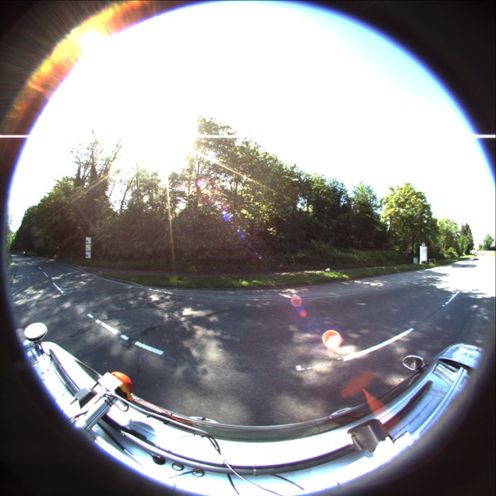
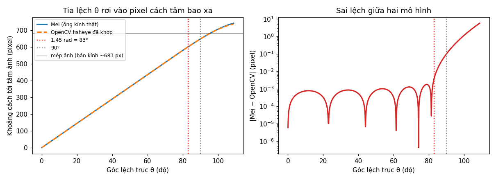
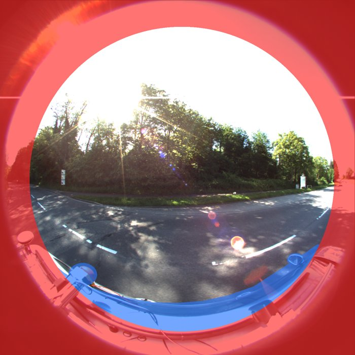
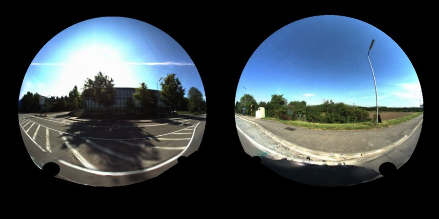
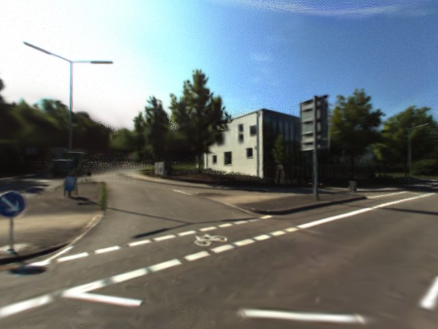

# Camera mắt cá KITTI-360: từ dữ liệu gốc tới video kết quả

Tài liệu này đi theo một ảnh của camera mắt cá `image_02` (chuỗi `2013_05_28_drive_0003_sync`, khung 507) qua toàn bộ pipeline của drive2sim, từ ảnh gốc trong dataset tới video tái dựng. Mọi hình đều lấy từ dữ liệu và kết quả thật trên máy (ngày 19/11/2026). Chi tiết kỹ thuật nằm ở `kitti360.md` mục 5, 5.1 và 8.

## 0. Tóm tắt

| Bước | Làm gì với ảnh | Làm gì với ống kính | Góc nhìn có nội dung |
|---|---|---|---|
| 1. Dữ liệu gốc | Ảnh PNG 1400×1400 | Mô hình **Mei** (ống kính thật) | khoảng 191° theo chiều ngang |
| 2. Ingest | Chép nguyên ảnh | Khớp Mei sang **OpenCV fisheye** | (chưa che gì) |
| 3. Nạp dữ liệu | Thu nhỏ 700×700, lập mặt nạ | Tính góc tia của từng pixel | **166°** (che ngoài 83° mỗi bên và thân xe) |
| 4. Train | Chỉ dùng pixel hợp lệ | Renderer vẽ qua OpenCV fisheye | 166° |
| 5. Video, điểm số | Tô đen cùng vùng ở ảnh render và ảnh thật | Như bước 4 | 166° |
| 6. Xem trên Studio | Trình duyệt vẽ pinhole | Spark chỉ có pinhole | tuỳ góc pinhole |

## 1. Ống kính là gì (khái niệm dùng trong cả tài liệu)

Mỗi điểm trong cảnh gửi một tia sáng tới camera. Tia lệch khỏi **trục nhìn** (đường thẳng chính giữa ống kính) một góc **θ**. Ống kính quyết định tia lệch θ rơi vào pixel cách **tâm ảnh** bao xa. "Mô hình ống kính" là công thức cho quy tắc đó.

- **Pinhole**: khoảng cách = f·tan θ. Khi θ tiến tới 90° thì khoảng cách tiến tới vô cực, nên pinhole không bao giờ thấy tới 90° lệch trục.
- **Mắt cá**: khoảng cách tăng gần đều theo θ, nên vẫn thấy được ở 90° và hơn.

θ đo **từ trục sang một bên**. Góc nhìn tổng là hai bên cộng lại: 83° mỗi bên là 166° tổng, 90° mỗi bên là 180° tổng.

## 2. Dữ liệu gốc

Trên máy: `data/kitti360/raw/` (một phần của chuỗi 0003: 204 khung, cứ 5 khung lấy 1; bản đầy đủ khoảng 8 GB nằm trên Kaggle).

| Thành phần | File |
|---|---|
| Ảnh 4 camera | `data_2d_raw/2013_05_28_drive_0003_sync_image_0{0,1,2,3}.tar` |
| LiDAR | `data_3d_raw/2013_05_28_drive_0003_sync.tar` |
| Calib mắt cá (Mei) | `calibration/image_02.yaml`, `image_03.yaml` |
| Calib pinhole | `calibration/perspective.txt` |

Ảnh gốc `image_02`, khung 507 (1400×1400, thu nhỏ để hiển thị):



Hai điều thấy ngay trên ảnh:
- **Vành ngoài** của hình tròn có nội dung thật: cây, mặt đường, bầu trời ở sát mép.
- **Thân xe ghi dữ liệu** ở nửa dưới: nóc xe, giá đỡ camera, dây cáp, gương. Camera gắn ở hông xe và nhìn rất rộng nên thấy cả xe của mình.

Calib của camera này theo **mô hình Mei** (`calibration/image_02.yaml`):

```yaml
model_type: MEI
mirror_parameters:   { xi: 2.2134 }            # ξ: độ "mắt cá"; ξ = 0 là pinhole
distortion_parameters: { k1: 0.0168, k2: 1.6549, p1: 0.00042, p2: 0.00042 }
projection_parameters: { gamma1: 1336.3, gamma2: 1335.8, u0: 716.9, v0: 705.8 }
```

Mô hình Mei (Mei và Rives, ICRA 2007) chiếu tia lên một mặt cầu đơn vị rồi chiếu tiếp lên mặt phẳng ảnh từ một tâm dời ra sau đoạn ξ. Nhờ vậy nó mô tả được ống kính nhìn hơn 180°. Theo calib này, mép trái và phải của ảnh ứng với khoảng **96° mỗi bên**, tức khoảng **191°** theo chiều ngang.

## 3. Ingest: chuyển ống kính Mei sang OpenCV fisheye

Converter: `drive2sim/ingest/kitti360.py` (cảnh `kitti360_drive0003` được ingest trên Kaggle).

1. **Ảnh**: chép nguyên PNG vào `images/<khung>_<camera>.png`. Không khử méo, không chiếu lại.
2. **Ống kính**: renderer của gsplat (3DGUT, 3DGEER) không có mô hình Mei, chỉ có pinhole, OpenCV fisheye và F-theta. `drive2sim/core/camera.py` khớp Mei sang **OpenCV fisheye** (khoảng cách = f·θ·(1 + k1θ² + k2θ⁴ + k3θ⁶ + k4θ⁸)) bằng bình phương tối thiểu trên góc 0–1,45 rad, rồi ghi 8 số `fx fy cx cy k1 k2 k3 k4` vào `intrinsics/2.txt`.
3. **Manifest**: camera ghi `model: opencv_fisheye` và `max_angle: 1.45` (giới hạn mà converter dùng; cảnh ingest trước 19/11/2026 lấy con số này ở báo cáo kiểm tra).
4. **Báo cáo kiểm tra** (`reports/validation.json`): `camera.fisheye_fit` (sai số khớp) và `camera.fisheye_fov` (giới hạn góc).

Hai mô hình đặt cạnh nhau, tính từ calib thật của `image_02`:



- Hình trái: tia lệch θ rơi vào pixel cách tâm bao xa. Hai đường gần như trùng nhau tới hơn 95°. Đường ngang xám là mép trái, phải của ảnh (khoảng 683 px từ tâm), ứng với khoảng 96°.
- Hình phải: độ lệch giữa hai mô hình (thang log).

| Góc lệch trục | Lệch giữa Mei và OpenCV fisheye |
|---|---|
| tới 83° (1,45 rad, miền dùng để khớp) | dưới 0,004 px |
| 90° | 0,1 px |
| 96° (mép trái, phải của ảnh) | 0,5 px |
| 99° | 1 px |
| 103° | 2 px |

Phép khớp vẫn bám ống kính thật dưới nửa pixel tới mép trái, phải của ảnh, dù chỉ được khớp tới 83°. Méo tiếp tuyến `p1`, `p2` (cỡ 4e-4) bị bỏ vì OpenCV fisheye không có; trên điểm LiDAR thật, tổng sai số chiếu là trung vị 0,10 px, lớn nhất 0,42 px (`kitti360.md` mục 5).

Sau ingest, máy chỉ giữ file nhỏ của cảnh (manifest, báo cáo, pose, calib); ảnh ở lại Kaggle.

## 4. Nạp dữ liệu: thu nhỏ và lập mặt nạ

Loader: `drive2sim/recon/data/loaders/kitti360.py`.

1. Đọc ảnh, **thu nhỏ còn 700×700**.
2. Dùng mô hình OpenCV fisheye để tính hướng tia và góc θ của **từng pixel**.
3. Lập **mặt nạ hợp lệ** (`valid_masks`). Pixel bị loại khi:
   - **θ > 1,45 rad (83°)**: vành ngoài;
   - nằm trong **mặt nạ thân xe** `drive2sim/assets/ego_masks/kitti360/image_02.png`.

Mặt nạ thân xe (trắng là che), do dự án vẽ một lần cho chuỗi 0003 vì KITTI-360 không cung cấp; đã xem trên khung 2, 257, 507, 759, 1009, chưa xác nhận trên chuỗi khác:


Cùng ảnh gốc ở bước 2, tô các vùng bị loại:



- **Đỏ**: ngoài 83°, 42% diện tích ảnh vuông (gồm cả vành có nội dung lẫn bốn góc đen nằm ngoài hình tròn ống kính).
- **Xanh**: mặt nạ thân xe nằm trong vùng 83°, thêm 5% diện tích ảnh.
- **Không tô**: phần dùng để train, đánh giá, xuất video.

Phần lớn thân xe vốn đã nằm trong vùng đỏ; mặt nạ thân xe chỉ che thêm phần nóc xe lấn vào trong 83°.

**Vì sao chọn 83°**: renderer **3DGUT** chiếu vài điểm mẫu của mỗi Gaussian qua ống kính, và phép chiếu hỏng khi điểm mẫu ở 90° hoặc sau camera; 1,45 rad nằm dưới 90° với khoảng an toàn. Bảng ở bước 3 cho thấy phép khớp ống kính không phải giới hạn: nó vẫn đúng dưới nửa pixel tới 96°.

## 5. Train

Renderer 3DGUT hoặc 3DGEER vẽ cảnh 3D qua **ống kính OpenCV fisheye** của camera đó, ra ảnh 700×700, rồi so với ảnh thật **chỉ trên pixel hợp lệ**. Vành ngoài và thân xe không góp vào sai số, nên model không học hai vùng này. Áp dụng cho mọi renderer: các run 3DGUT (`146b`, `e627`) và 3DGEER (`e3e3`, `0b27`) đều train trên 166°.

## 6. Video và điểm số

`drive2sim/recon/rendering/videos.py`:

1. Renderer vẽ **mọi pixel** của khung test.
2. Ảnh render (`rgbs`) và ảnh thật (`gt_rgbs`) cùng được **nhân với mặt nạ**: pixel hợp lệ giữ màu, pixel không hợp lệ thành đen (tô đen).
3. PSNR, SSIM, LPIPS chỉ tính trên pixel hợp lệ.
4. Ghép thành MP4 trong `runs/<cảnh>/omnire/<run>/d2s/stages/train.drivestudio/videos/`.

Khung test của run `e3e3` (3DGEER, split `every10_fisheye2`; trái `image_02`, phải `image_03`):

Ảnh thật sau khi che (`test_set_30000_gt_rgbs.mp4`):


Ảnh tái dựng (`test_set_30000_rgbs.mp4`):



- `gt_rgbs` là ảnh camera thật, chỉ thu nhỏ và tô đen; nội dung bên trong không bị biến đổi.
- `rgbs` là ảnh model vẽ qua OpenCV fisheye, tô đen cùng chỗ.
- Hai video cùng khung, cùng vị trí vật, cùng độ cong; vành ngoài đen ở cả hai nên trông khớp nhau. Ảnh thật nguyên bản (bước 2) vẫn có nội dung ở vành đó: cảnh dựng lại thiếu phần này, và điểm số không phản ánh phần thiếu.

## 7. Xem trên Studio

| Chế độ | Ống kính | Ghi chú |
|---|---|---|
| Video | Mắt cá (bước 6) | Giống video kết quả |
| Gói xem trước (trình duyệt) | Pinhole | Spark chỉ vẽ được pinhole; thanh trượt "Góc nhìn" đổi góc pinhole, giới hạn trên là góc thật của camera (166°) |
| Ảnh chính xác khi dừng tay, Render GPU | Pinhole mặc định | Renderer gốc vẽ được mắt cá nhưng Studio chưa có lựa chọn này |

Cùng model `e3e3`, vẽ bằng renderer gốc qua camera **pinhole 90°** đặt ở vị trí `image_02`: đường thẳng giữ thẳng, góc nhìn hẹp hơn ảnh mắt cá:



Vấn đề khi trình duyệt dùng tiêu cự của camera mắt cá trong phép chiếu pinhole (góc khoảng 119°, mép bị kéo giãn): ARCHITECTURE mục 2.13.

## 8. Giới hạn và hướng mở

| | Hiện trạng |
|---|---|
| Trong 166° | Ảnh tái dựng đúng vị trí so với camera thật (sai số chiếu dưới nửa pixel) |
| Vành ngoài 166° tới khoảng 191° | Không có trong cảnh dựng lại; ảnh thật có |
| Lý do | 3DGUT không vẽ được từ 90° trở ra; con số 83° được chọn chung cho mọi renderer |
| 3DGEER | Tính theo tia nên không có giới hạn 90°. Phép khớp OpenCV fisheye hiện có vẫn đúng dưới 0,5 px tới 96°, nên nới vùng che khi dùng 3DGEER có thể lấy lại phần lớn vành ngoài mà không cần đổi mô hình ống kính. **Chưa kiểm chứng bằng train.** |
| Thử thuật toán lái xe, perception | Dùng được với thuật toán chỉ cần vùng giữa ảnh mắt cá; khi so với ảnh thật, che cùng vành ngoài trên ảnh thật |

## Nguồn hình

Tạo ngày 19/11/2026 từ dữ liệu trên máy:
- `01`, `02`: `data/kitti360/raw/data_2d_raw/2013_05_28_drive_0003_sync_image_02.tar`, khung `0000000507.png`; vùng bị loại tính từ `data/kitti360_drive0003/intrinsics/2.txt` và mặt nạ thân xe.
- `03`: `drive2sim/assets/ego_masks/kitti360/image_02.png`.
- `04`: `calibration/image_02.yaml` (Mei) và `intrinsics/2.txt` (OpenCV fisheye), hàm `mei_radius`, `fisheye_radius` của `core/camera.py`.
- `05`: khung thứ 6 của `test_set_30000_gt_rgbs.mp4` và `test_set_30000_rgbs.mp4`, run `20261117-085343-omnire-e3e3`.
- `06`: frame server (`recon/tools/frame_server.py`), run `e3e3`, pose `image_02` khung 20, camera pinhole 640×480, f = 320 px.
