# Báo cáo tiến độ tuần 01 · 07/11/2026

Reconstructing Real-World Driving Scenes (Real2Sim) · Tuần 01: 01/11/2026 – 07/11/2026 · Lâm Quang Anh Quân, Lương Sỹ Khánh, Đặng Thái Anh, Phạm Minh Hiếu

## Quy ước thuật ngữ

{{thuat-ngu}}

## 1. Tóm tắt

{{tien-do}}

Tuần đầu tiên, nhóm tập trung xác định bài toán và thiết kế trước khi chạy thử bất kỳ phương pháp nào. Các việc chính gồm:

- **Report chung:** nhóm dựng khung một report kỹ thuật chung cho cả nhóm, gồm 3 part và 17 chương. Ch 1 và Ch 3 đã có bản nháp, Ch 2 viết xong tới mục 2.5.
- **Yêu cầu và phạm vi:** nhóm đặc tả 8 nhóm yêu cầu và 6 sản phẩm bàn giao. Trong 6 tuần, nhóm cam kết hoàn thành M0–M2; các mốc M3–M5 làm theo mức khả thi.
- **Kiến trúc:** nhóm vẽ kiến trúc tham chiếu của một hệ thống Real2Sim, gồm 5 subsystem chạy theo 2 giai đoạn (offline và online).
- **Tool thử nghiệm:** để so sánh được nhiều method, tool sẽ chuẩn hoá cách nối các method với nhau (dataset, calibration, contract, metric) chứ không chuẩn hoá thuật toán bên trong.
- **CARLA:** riêng cảnh 3DGS thì chưa đủ để chạy trong CARLA. Hệ thống còn phải sinh thêm bản đồ đường `map.xodr`, quỹ đạo của từng vật thể (xe, người), quỹ đạo xe ego, calibration và phép biến đổi toạ độ.
- **Tuần sau:** bắt đầu dựng tool và chạy thử các method, đồng thời chờ mentor xác nhận phạm vi.

## 2. Vị trí trên lộ trình

Dự án đang ở mốc M0, tức là thiết kế kiến trúc, interface và contract giữa các khối.

{{lo-trinh}}

## 3. Đối chiếu với kế hoạch tuần trước

Đây là tuần đầu tiên nên chưa có kế hoạch từ tuần trước để đối chiếu. Bảng dưới liệt kê các việc nhóm đặt ra và làm trong tuần.

{{thay-doi}}

## 4. Chi tiết công việc đã làm

Tuần này nhóm làm bốn việc nối tiếp nhau: dựng một report chung để cả nhóm cùng ghi kiến thức vào, xác định yêu cầu và phạm vi của dự án, thiết kế kiến trúc hệ thống cùng tool thử nghiệm, và tìm hiểu cách đưa cảnh tái dựng vào CARLA.

### 4.1 Report kỹ thuật chung

Nhóm dựng một report kỹ thuật chung để gom kiến thức của mọi thành viên vào một file. Nhờ vậy các thành viên không làm trùng việc của nhau, và ai cũng theo dõi được tình hình chung của dự án. Mỗi thành viên viết chương của mình theo cùng một mẫu. Report chia làm 3 part, tương ứng với 3 phase làm việc:

| Part | Phase | Chương |
|---|---|---|
| I. Shared Foundation | 1: cả nhóm đọc và thống nhất | Ch 1 Bài toán và yêu cầu · Ch 2 Kiến trúc tham khảo · Ch 3 Tool thử nghiệm · Ch 4 Quy trình đánh giá · Ch 5 Khảo sát method · Ch 6 Kế hoạch nghiên cứu |
| II. Approach Studies | 2: mỗi thành viên một chương | Ch 7–10 Approach A–D · Ch 11 Road logic và CARLA |
| III. Synthesis | 3: cả nhóm tổng hợp | Ch 12 So sánh · Ch 13 Pipeline cuối · Ch 14 Kiểm chứng tool · Ch 15 Tích hợp CARLA · Ch 16 Kết luận |

Ngoài ba part trên, Ch 17 tổng hợp các khái niệm dùng chung trong report như ADAS, resimulation, open-loop và closed-loop.

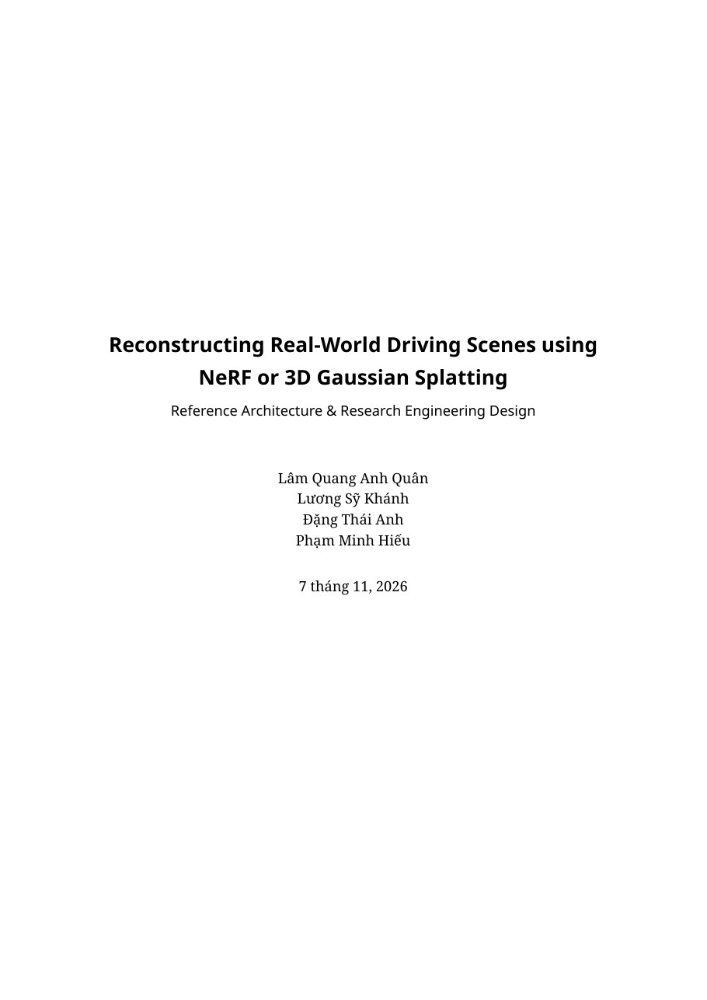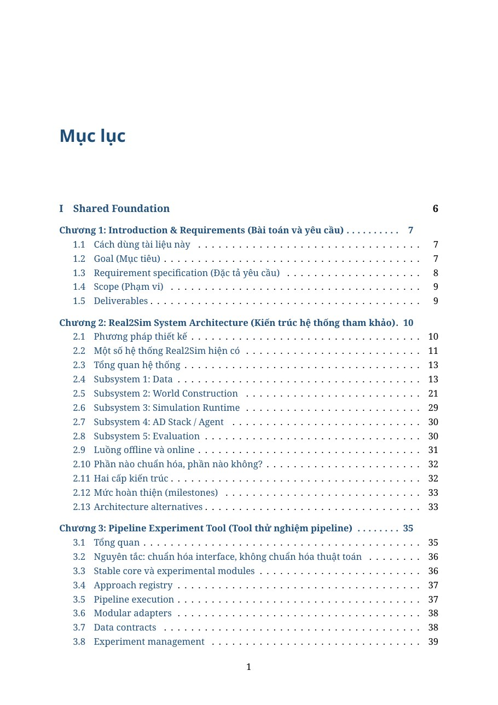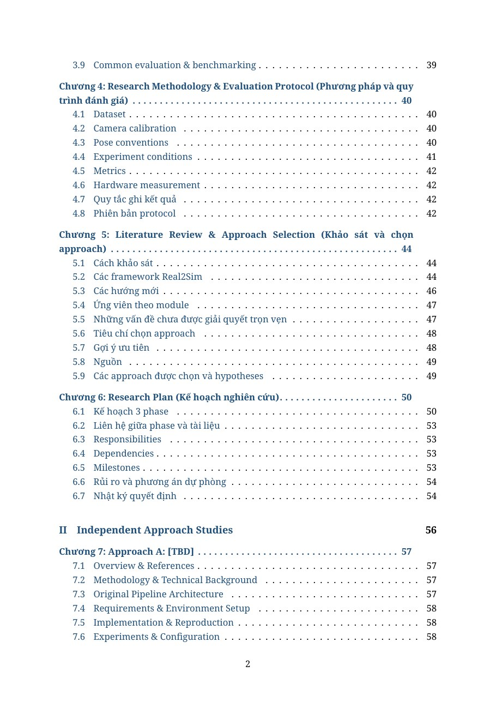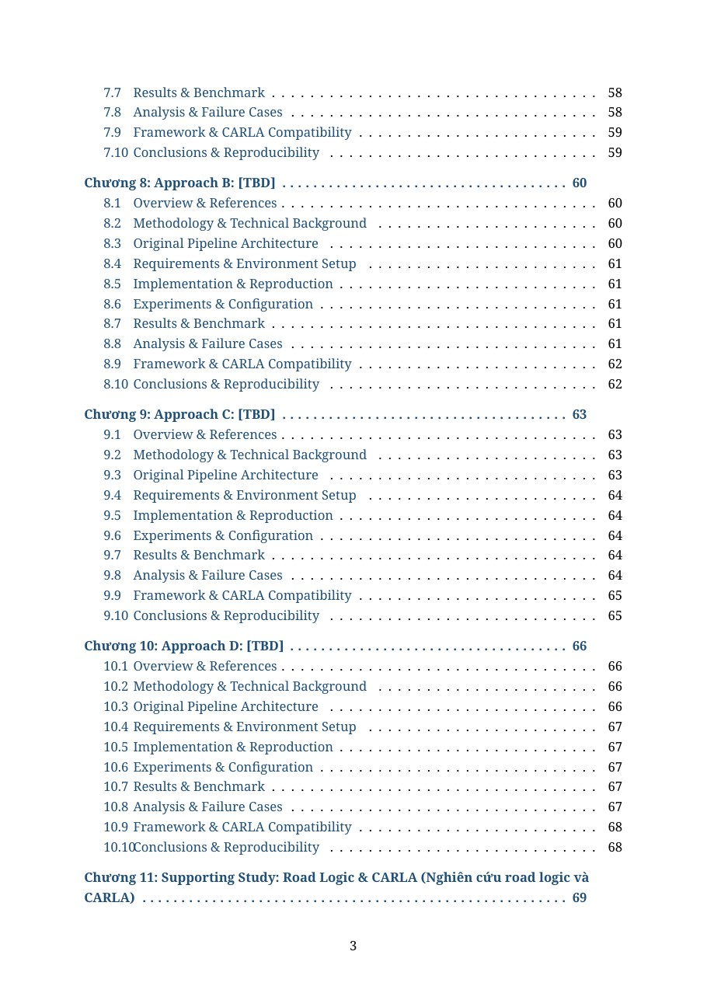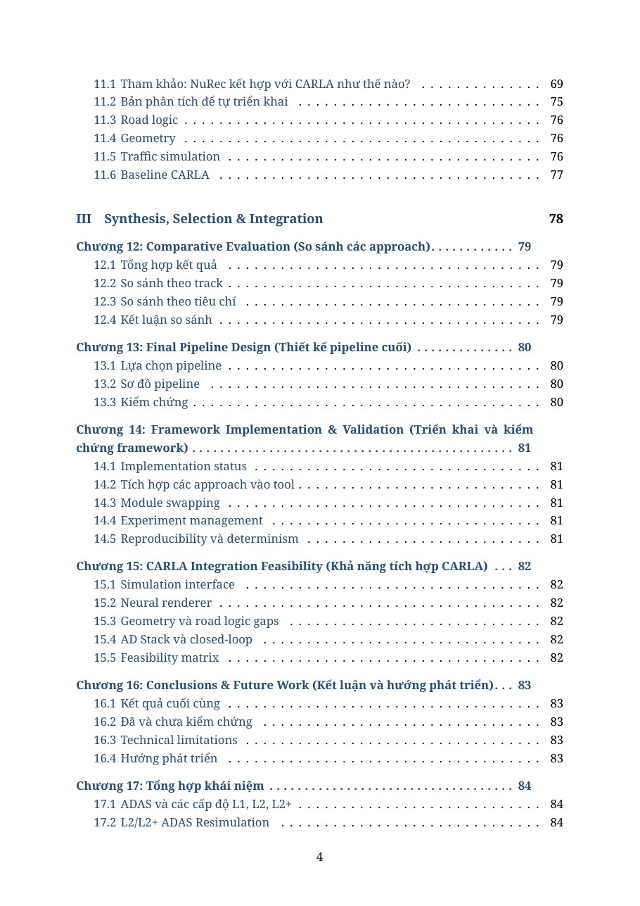

*Hình 1. Report chung: trang bìa và mục lục Ch 1–17.*

Tính đến cuối tuần, phần lớn các chương mới có bản nháp hoặc khung. Các chương phụ thuộc vào dataset và phân công (Ch 4, Ch 6) phải chờ hai việc đó được chốt:

| Phần | Trạng thái |
|---|---|
| Ch 1, Ch 3 | Đã có bản nháp |
| Ch 2 | Đang sửa: xong tới 2.5, tiếp theo 2.6–2.8 |
| Ch 4, Ch 6 | Bản nháp, chờ chốt dataset và phân công |
| Ch 5 | Đã khảo sát 6 framework, chưa chốt 4 method |
| Part II | Có mẫu chương; Ch 11 đã có phân tích NuRec + CARLA |
| Part III | Mới có khung |

### 4.2 Mục tiêu, đặc tả và phạm vi

Trước khi chọn công nghệ, nhóm xác định thế nào là một kết quả tốt cho dự án. Kết quả tốt không nhất thiết là cảnh đẹp nhất. Điều cần chứng minh là phương pháp nào tái dựng được dữ liệu camera pinhole/fisheye kèm LiDAR, với chất lượng, chi phí và khả năng đưa vào mô phỏng đều đo được.

Từ mục tiêu đó, nhóm đặc tả yêu cầu theo thứ tự công việc:

1. Dữ liệu đầu vào: camera pinhole/fisheye và LiDAR; mức tối thiểu là chỉ có video hoặc ảnh.
2. Khảo sát và đánh giá các method triển vọng.
3. Tool thử nghiệm: chạy được nhiều method, đổi được thuật toán trong từng module và thứ tự các module.
4. Kết quả tái dựng: reconstruction pipeline và scene demo.
5. Đưa vào CARLA: đánh giá tính khả thi, road logic, traffic, closed-loop trên một khu vực thật.
6. Tiêu chí chất lượng: chi phí thấp, mở rộng được (scalability) và kết quả lặp lại được (determinism).
7. Báo cáo: phần đánh giá và technical report.
8. Nên có nếu kịp: mô hình cảm biến và mô hình xe.

Mỗi yêu cầu ứng với một sản phẩm bàn giao. Bảng dưới là các sản phẩm và điều kiện nghiệm thu nhóm đề xuất, để mentor xác nhận:

| Deliverable | Định dạng | Điều kiện nghiệm thu đề xuất |
|---|---|---|
| Tool thử nghiệm pipeline | Mã nguồn, hướng dẫn chạy | Đổi được method và thứ tự module, chạy lại được |
| Reconstruction pipeline | Mã nguồn và config | Chạy được từ dữ liệu đến ảnh render |
| Scene demo | Video và file scene | Render được đoạn đường đã chọn |
| Bảng benchmark | Bảng số liệu và log | Cùng dataset, cùng protocol |
| CARLA feasibility study | Một chương trong báo cáo | Có bảng khả thi, nêu rõ hạn chế |
| Technical report | PDF | Đủ các chương, được mentor đánh giá |

### 4.3 Kiến trúc tham chiếu

Để biết một hệ thống Real2Sim cần những khối nào, nhóm xem cách các hệ thống hiện có được tổ chức. Các hệ thống này đi theo cùng một luồng chung, nhưng mỗi hệ thống chỉ làm tốt một phần: NuRec mạnh về dựng cảnh và render nhưng tự nó không chạy mô phỏng; HUGSIM có simulator closed-loop riêng nhưng không chạy trên CARLA; Cam2Sim chạy trên CARLA nhưng mới đặt được xe đỗ, chưa có giao thông động.

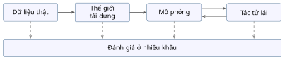

*Hình 2. Luồng chung của các hệ thống Real2Sim; đánh giá diễn ra ở nhiều khâu.*

Dựa trên luồng chung đó, nhóm đề xuất một kiến trúc tham chiếu gồm 5 subsystem: Data, World Construction, Simulation Runtime, AD Stack và Evaluation. Các khối này chạy theo hai giai đoạn: giai đoạn offline dựng thế giới một lần, còn giai đoạn online lặp lại ở mỗi bước mô phỏng.

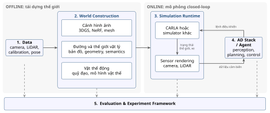

*Hình 3. Kiến trúc tham chiếu: 5 subsystem, 2 giai đoạn.*

Khối Data là điểm bắt đầu của mọi pipeline nên được thiết kế chi tiết hơn. Dữ liệu có thể vào theo hai đường nhưng cuối cùng đều thành một dataset chuẩn. Đường thứ nhất là dataset có sẵn, dùng luôn calibration, pose và nhãn đi kèm. Đường thứ hai là log thô chỉ có video hoặc ảnh, khi đó hệ thống phải tự tạo phần còn thiếu. Pipeline vẫn chạy được khi chỉ có camera; LiDAR giúp cảnh có tỉ lệ thật và hình học chính xác hơn.

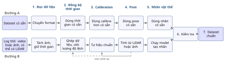

*Hình 4. Luồng xử lý của subsystem Data.*

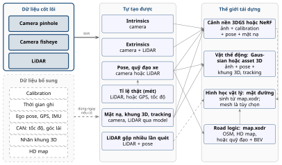

*Hình 5. Các loại dữ liệu và những gì tạo ra được từ chúng.*

### 4.4 Thiết kế tool thử nghiệm

Dự án yêu cầu khảo sát nhiều method rồi chọn hướng tốt nhất. Muốn chọn đúng thì phải chạy thật từng method và so sánh chúng với nhau, vì vậy nhóm cần một tool để chạy, thay đổi và đánh giá các pipeline. Tool này là công cụ nghiên cứu, khác với hệ thống Real2Sim cuối cùng.

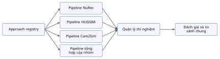

*Hình 6. Cấu trúc tool; các pipeline chỉ là ví dụ ứng viên.*

Khó khăn chính là các method được viết độc lập, nên không thể ghép thẳng chúng vào một tool chung. Bảng dưới liệt kê các khác biệt nhóm gặp và hậu quả của từng khác biệt:

| Vấn đề | Hậu quả |
|---|---|
| Mỗi method có format dữ liệu riêng | Phải viết lại phần đọc dữ liệu cho từng method |
| Thứ tự bước khác nhau, có method gộp nhiều bước | Không ép được vào một pipeline cứng |
| Output khác nhau: 3DGS, NeRF, mesh | Các phần phía sau không đọc chung được |
| Khả năng khác nhau: pinhole, fisheye, LiDAR | Không phải method nào cũng làm được mọi việc |
| Mỗi người đo một cách | Kết quả không so sánh được |
| Repository có sẵn không tự cắm vào được | Cần code nối riêng cho từng method |

Để giải quyết các khác biệt này, tool giữ cố định những gì cần giống nhau để kết quả so sánh được: format dataset, thời gian, hệ toạ độ, calibration, cấu hình thí nghiệm, metric và log. Những phần thật sự khác nhau giữa các method thì được phép thay đổi: pose, reconstruction, renderer, trích xuất geometry, road logic và adapter nối với simulator.

Vì kiến trúc lúc này mới là dự đoán, nhóm làm theo vòng lặp: thiết kế trước, chạy thử thật, rồi sửa kiến trúc nếu kết quả thử không khớp.

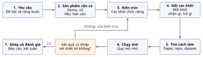

*Hình 7. Các bước thiết kế: thiết kế trước, thử thật, rồi sửa kiến trúc theo kết quả.*

### 4.5 Tích hợp CARLA

Mục tiêu cuối của dự án là chạy mô phỏng trong CARLA, nên nhóm tìm hiểu xem một cảnh 3DGS cần thêm gì để vào được CARLA. Cảnh 3DGS chỉ dùng để render ảnh: CARLA không biết đâu là làn đường, giao lộ hay vật cản trong cảnh, và kết nối gRPC chỉ truyền ảnh chứ không truyền thông tin va chạm. Vì vậy, ngoài cảnh 3DGS, hệ thống còn phải sinh thêm:

- bản đồ `map.xodr` theo chuẩn OpenDRIVE, mô tả đường và làn;
- quỹ đạo của từng vật thể (xe, người), để tạo lại chúng trong CARLA;
- quỹ đạo và calibration, để đặt xe và camera đúng chỗ;
- phép biến đổi toạ độ, để khớp hệ toạ độ của CARLA với cảnh.

Bản đồ `map.xodr` có thể tạo theo hai cách. Khi có GPS, nhóm tải bản đồ OpenStreetMap rồi chuyển đổi bằng `carla.Osm2Odr`. Khi không có GPS, nhóm tạo bản đồ từ quỹ đạo xe, rồi bổ sung số làn và bề rộng làn đo trên ảnh nhìn từ trên xuống (BEV).

Để có một ví dụ thực tế, nhóm xem cách NVIDIA nối hệ thống NuRec với CARLA. Một script Python gọi cả hai bên: CARLA chạy ở chế độ đồng bộ với bước 1/60 giây, và ở mỗi bước script lấy vị trí camera từ CARLA, đổi sang hệ toạ độ của cảnh, rồi gọi `render_rgb` để lấy ảnh. Nhóm có thể làm lại cách nối này cho các method khác.

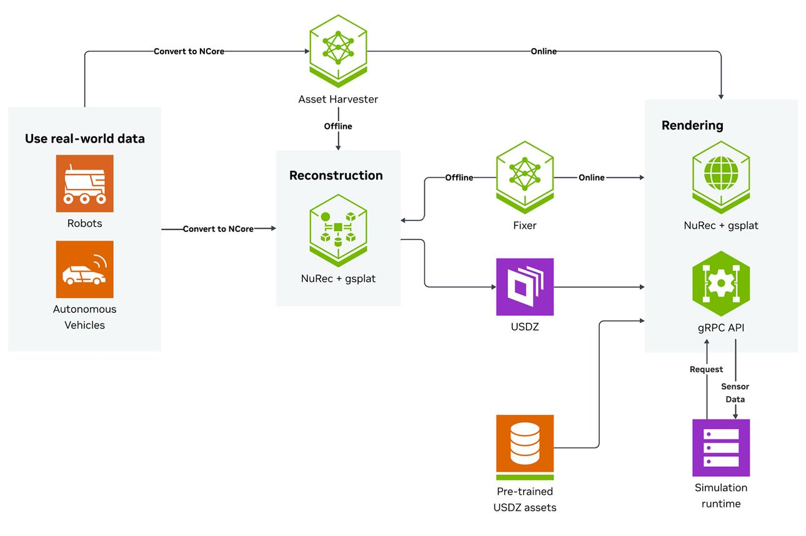

*Hình 8. Pipeline của NVIDIA NuRec (ảnh: NVIDIA Developer).*

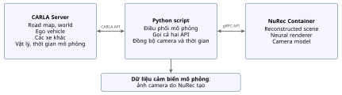

*Hình 9. NuRec và CARLA: ba thành phần chạy riêng biệt.*

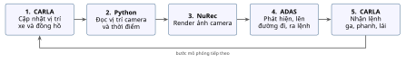

*Hình 10. Một vòng closed-loop giữa CARLA và renderer.*

## 5. Kết quả thực nghiệm

Tuần này chưa có thực nghiệm, vì nhóm dành thời gian cho thiết kế ở mục 4. Các lần chạy thử đầu tiên nằm trong kế hoạch tuần sau (mục 7).

## 6. Phát hiện và quyết định

Từ các việc ở mục 4, nhóm chốt bốn quyết định định hướng cho các tuần sau.

*Ghi chú: các quyết định chốt trong tuần, mỗi quyết định kèm lý do và nguồn (mục trong báo cáo, paper hoặc tài liệu).*

| Quyết định | Lý do / bằng chứng | Nguồn |
|---|---|---|
| Một report chung cho cả nhóm | Tránh làm trùng việc, dễ theo dõi tình hình | Mục 4.1 (Report kỹ thuật chung) |
| Cam kết M0–M2 trong 6 tuần, M3–M5 theo mức khả thi | Thiết kế đầy đủ cho cả hệ thống, nhưng triển khai tăng dần | Mục 4.2 (Mục tiêu, đặc tả và phạm vi) |
| Tool chuẩn hoá cách nối, không chuẩn hoá thuật toán | Mỗi method có format, thứ tự bước và output khác nhau | Mục 4.4 (Thiết kế tool thử nghiệm) |
| Hệ thống phải sinh thêm `map.xodr` và quỹ đạo vật thể ngoài cảnh 3DGS | CARLA không đọc được làn và vật cản từ 3DGS | Mục 4.5 (Tích hợp CARLA); tài liệu CARLA, NVIDIA NuRec |

## 7. Kế hoạch tuần sau

Sau khi có thiết kế, việc tiếp theo là dựng tool và chạy thử thật để kiểm tra thiết kế đó có đứng vững không.

{{ke-hoach}}

## 8. Hạn chế, rủi ro và câu hỏi còn mở

Phạm vi của dự án chưa được mentor xác nhận, nên nhóm cần câu trả lời cho các câu hỏi sau trước khi đi sâu vào triển khai:

1. Cách làm một report chung như vậy có đúng không? Cả nhóm nộp một bản report được không?
2. Đặc tả yêu cầu và deliverables đã đúng và đủ chưa?
3. Closed-loop là bắt buộc trong 6 tuần, hay chỉ cần đánh giá khả năng tích hợp?
4. Tool thử nghiệm có phải là deliverable chính thức không?
5. Cam kết M0–M2 trong 6 tuần có đạt yêu cầu không?
6. Dữ liệu chính là dataset công khai hay log do mentor cung cấp?
7. Road logic có cần giao lộ đầy đủ không?

## 9. Bảng tổng hợp công việc

{{bang-cong-viec}}
