# Báo cáo tiến độ tuần 03 · 21/11/2026

Reconstructing Real-World Driving Scenes (Real2Sim) · Tuần 03: 15/11/2026 – 21/11/2026

## Quy ước thuật ngữ

{{thuat-ngu}}

## 1. Tóm tắt

{{tien-do}}

Tuần này các thực nghiệm lần đầu chạy qua drive2sim với cùng một protocol đánh giá, nên kết quả của các cấu hình đã so được với nhau. Từ đó nhóm thiết kế benchmark cho tuần sau.

- **Dựng từng cảnh (per-scene optimization), camera pinhole, nuScenes scene-0061:** nhóm so 11 cấu hình của hai method OmniRe và Street GS. Cấu hình OmniRe + 3DGS + Faster-GS cho PSNR cao nhất, 25,20 dB. Thêm FastGS vào cấu hình làm model nhỏ đi 2,8 lần mà PSNR chỉ kém khoảng 0,2 dB. Khi chỉ đổi renderer trong cùng cấu hình OmniRe + FastGS + Faster-GS, 3DGUT kém 3DGS 1,0 dB, còn 3DGEER kém 3,2 dB.
- **Dựng từng cảnh, camera fisheye, KITTI-360:** nhóm so hai renderer 3DGUT và 3DGEER trong cùng cấu hình OmniRe + FastGS + Faster-GS (4 run). Trên ảnh fisheye, hai renderer ngang nhau (khoảng 23 dB). Khi train chung pinhole và fisheye, 3DGUT tốt hơn 2,35 dB, vì 3DGEER chỉ đạt khoảng 20 dB trên ảnh pinhole.
- **Quãng đường dài (long-drive):** method KiloGS-SLAM chạy hết chuỗi KITTI 06 (1.101 khung, khoảng 1,2 km) trong 40 phút trên T4, với sai số quỹ đạo ATE 1,37 m và PSNR keyframe 21,99 dB. Nhóm chọn method MCGS-SLAM (dùng nhiều camera) cho track B của benchmark (quãng đường dài).
- **Method khác:** BezierGS trên Waymo 017 đạt 29,91 dB test (trung bình trong paper là 31,51 dB). SimULi phải dừng do lỗi của gsplat 1.6.
- **Feed-forward và CARLA:** Instant NuRec dựng được cảnh KITTI-360 với cả 4 camera, nhưng mới đạt khoảng 16 dB (trời chưa được ghép, mặt đường nhoè, không có xe động). Cảnh NuRec đã chạy được trong CARLA cùng 4 xe NPC, là bản thử đầu tiên của bước tích hợp CARLA.
- **Benchmark:** nhóm đã thiết kế xong benchmark gồm 8 yêu cầu, 3 track xếp hạng riêng (A dựng từng cảnh, B quãng đường dài, C feed-forward) và 13 run ưu tiên (khoảng 23 GPU-giờ).
- **Tuần sau:** dựng tool benchmark, chạy 13 run theo ma trận, và đánh giá dataset PHENIKAA.

## 2. Vị trí trên lộ trình

Mốc M1 đã xong, vì các run đã chạy qua drive2sim với cùng protocol đánh giá. Mốc M2 (benchmark) đang làm: thiết kế đã xong nhưng chưa chạy. Track A (dựng từng cảnh) và track B (quãng đường dài) đã có run thử; track C (feed-forward) có run thử Instant NuRec chạy ngoài tool (mục 5.5). Mốc M3 (thế giới sẵn sàng cho mô phỏng) bắt đầu với bản thử đưa cảnh NuRec vào CARLA.

{{lo-trinh}}

## 3. Đối chiếu với kế hoạch tuần trước

Tuần trước nhóm đặt ra năm việc, xoay quanh quãng đường dài, cách đánh giá và các method chưa chạy được. Bảng dưới cho biết từng việc đã đi tới đâu, cùng các việc tiếp tục từ trước và các việc phát sinh trong tuần.

{{thay-doi}}

## 4. Chi tiết công việc đã làm

Để các thực nghiệm ở mục 5 chạy được và so được với nhau, nhóm nâng cấp tool drive2sim. Song song, nhóm thiết kế benchmark cho tuần sau và chọn dataset cho track A (dựng từng cảnh).

### 4.1 Nâng cấp tool drive2sim

Sau tuần này, tool đã đủ để chạy, so sánh và xem kết quả của nhiều method trên nhiều dataset. Mỗi phần nâng cấp dưới đây xuất phát từ một vấn đề gặp khi chạy tuần trước:

- **Method mới:** benchmark cần method cho từng ô và từng track (mục 4.2). Vì vậy nhóm thêm PVG và DeformableGS (dựng từng cảnh mà không cần box 3D, cho ô A-L), OmniRe nhiều camera, và method feed-forward Instant NuRec (cho track C).
- **Fisheye:** trước đây mọi camera fisheye bị che cố định từ 83° lệch trục, nhưng mỗi ống kính nhìn được tới một góc khác nhau (image_02 tới 96,1°, image_03 tới 92,5°). Một con số chung vì vậy hoặc bỏ phí phần ảnh dùng được, hoặc giữ phần ảnh sai. Nay góc dùng được của từng camera được tính từ calibration của chính camera đó, vùng đen ngoài ống kính được dò từ ảnh, và thân xe được che, nên cách che đúng với mọi dataset. Ngoài ra cả 3DGUT và 3DGEER dừng ở 88°, vì renderer không vẽ được gì ngoài 90° (mục 5.3).
- **Đánh giá:** protocol 0.2 cũ tính SSIM và LPIPS trên hai ảnh đã tô đen vùng không hợp lệ (ngoài ống kính, thân xe). Các vùng đen giống hệt nhau đó làm điểm tốt hơn thực tế, nhất là với ảnh fisheye có nhiều vùng đen. Protocol 0.3 chỉ tính trên pixel hợp lệ, và báo thêm metric theo từng camera để thấy chênh lệch đến từ camera nào. Để run cũ vẫn so được với run mới, tool tự đo lại từ checkpoint khi metric của run cũ hơn protocol hiện tại.
- **Studio (giao diện web):** khi số run tăng lên (hơn hai mươi run tới cuối tuần), nhóm cần xem và so chúng mà không phải đọc từng file kết quả. Studio có bảng so sánh run, lịch densify, viewer 3D, ghép video của hai run, upload dữ liệu từ máy hoặc Google Drive qua Colab, cài môi trường ngay từ Studio, và trợ lý đề xuất cấu hình run.
- **Kaggle/Colab:** máy T4 của Kaggle có 2 GPU nhưng mỗi notebook trước đây chỉ dùng một, trong khi quota GPU tính theo thời gian notebook. Nay một notebook chạy được hai run song song, mỗi run một GPU. Notebook cũng dùng lại wheel đã build và cache tiền xử lý của notebook trước, vì riêng bước build môi trường đã mất khoảng nửa giờ mỗi lần.

### 4.2 Thiết kế benchmark

Các thực nghiệm đến tuần này mới đo PSNR trên ảnh nội suy, nên chưa trả lời được method nào phù hợp để chạy closed-loop. Vì vậy nhóm thiết kế một benchmark so các method (và cấu hình của chúng) theo mức phù hợp với closed-loop và theo chi phí. Ngoài PSNR trên khung test, benchmark còn đo ảnh khi xe đi lệch làn, chất lượng file `.ply` xuất ra, độ sạch của cảnh nền (không dính xe thật) và những đoạn đường bị hỏng. Để kết quả so được với nhau, mọi method, dù chạy trong drive2sim hay trong notebook riêng, đều giao cùng một bộ file và được chấm bởi cùng một bộ đo.

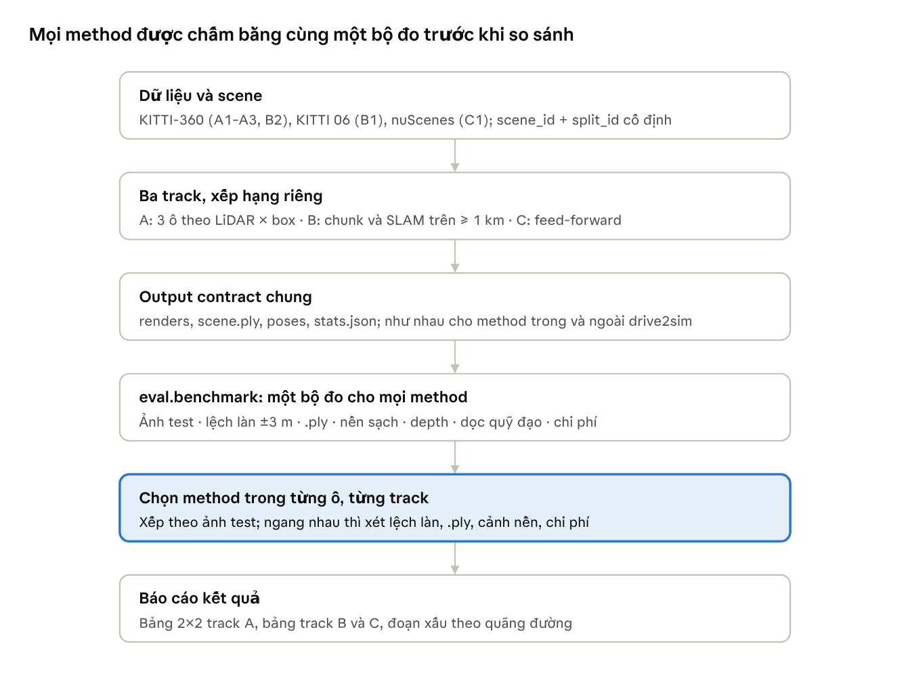

*Hình 1. Luồng đánh giá 6 bước: mọi method được chấm bằng cùng một bộ đo.*

Từ mục tiêu closed-loop, nhóm rút ra 8 yêu cầu mà benchmark phải đo, mỗi yêu cầu có metric riêng:

| # | Yêu cầu | Metric chính |
|---|---|---|
| R1 | Ảnh render giống ảnh thật trên khung giữ lại | PSNR, SSIM, LPIPS, Avg của Mip-NeRF; theo camera; vùng xe, người |
| R2 | Vẫn dùng được khi xe đi lệch quỹ đạo gốc | KID khi dịch camera ngang 0, ±1, ±2, ±3 m; PSNR trên split stereo |
| R3 | Chất lượng file `.ply` xuất ra | Chênh PSNR render gốc so với render `.ply` (export gap); số Gaussian, dung lượng |
| R4 | Cảnh nền sạch, đúng hình học | static_psnr, ghost_ratio; depth so với LiDAR (AbsRel, RMSE, δ < 1,25) |
| R5 | Chạy được với pinhole và fisheye, có hoặc không LiDAR | Mọi metric R1–R3 báo riêng pinhole và fisheye |
| R6 | Phủ trên 1 km đường | ATE; PSNR quanh chỗ nối chunk; thời gian mỗi 100 m |
| R7 | Biết cảnh hỏng ở đoạn nào | PSNR, LPIPS theo quãng đường; đoạn xấu = ≥ 5 khung liền thấp hơn trung vị quá 2 dB |
| R8 | Chi phí thấp, kết quả xác định | Thời gian train, VRAM đỉnh, FPS render |

Các yêu cầu trên được tổ chức thành benchmark như sau:

- **Ba track xếp hạng riêng:** benchmark chia các method thành ba nhóm không so trực tiếp với nhau, gọi là track. Track A là dựng từng cảnh (per-scene optimization) trên đoạn ngắn khoảng 200 khung; track B là quãng đường dài từ 1 km trở lên; track C là dựng tức thì (feed-forward). Track A chia tiếp theo đầu vào có hay không có LiDAR và box 3D, thành ba ô A-LB, A-L và A-0, để đo riêng LiDAR và box đóng góp bao nhiêu. Ô thứ tư (có box, không LiDAR) không chạy, vì box 3D trong các dataset luôn được gán nhãn trên LiDAR, nên không có dữ liệu thật nào có box mà thiếu LiDAR. Lưu ý: "track" ở đây không phải loại camera; pinhole và fisheye là hai loại camera dùng trong cả ba track.
- **Scene:** KITTI-360 là bộ chính, vì đây là bộ công khai có đủ 2 camera pinhole, 2 camera fisheye, LiDAR, pose và box 3D, và nhóm đã chạy cả 3DGS, 3DGUT, 3DGEER trên nó (mục 5.2). Tên scene bắt đầu bằng chữ cái của track dùng nó: A1 là drive_0003 khung 0–199 với 2 pinhole; A2 thêm 2 fisheye; A3 là một đoạn khoảng 200 khung có rẽ hoặc ngã tư; B1 là KITTI Odometry 06; B2 là khoảng 1 km liền trên KITTI-360; C1 là nuScenes scene-0103 và scene-0553.
- **Quy tắc chọn method:** xếp theo chỉ số Avg của Mip-NeRF. Hai method chênh dưới 0,3 dB PSNR được coi là ngang nhau, vì các run cũ cho thấy hai cấu hình gần giống nhau đã lệch 0,05–0,2 dB. Khi ngang nhau, nhóm xét tiếp lệch làn, chất lượng `.ply`, độ sạch cảnh nền, rồi đến chi phí.
- **Nguồn của cách đo:** mức lệch ±3 m lấy theo EUVS; cách đo bằng KID theo NeuRAD và SplatAD.

Hình dưới cho thấy cách chia track A (dựng từng cảnh): mỗi cặp ô so sánh chỉ khác nhau đúng một đầu vào, nên chênh lệch kết quả cho biết đầu vào đó đóng góp bao nhiêu.

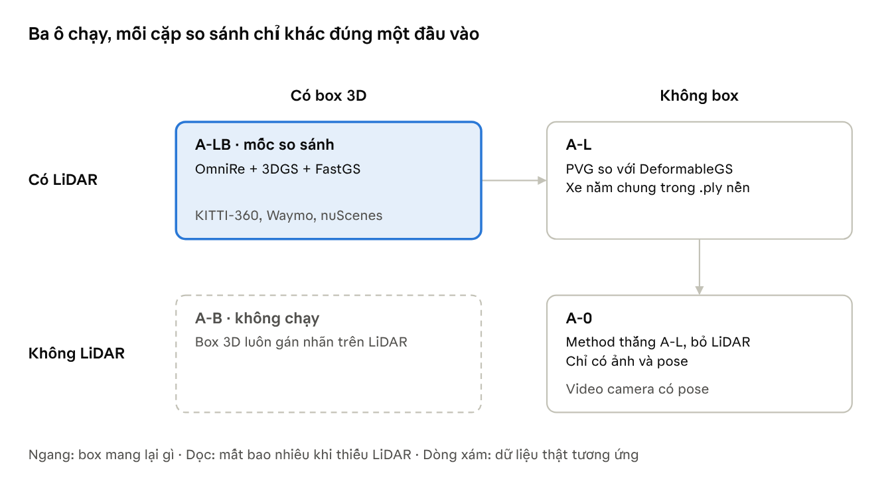

*Hình 2. Track A (dựng từng cảnh): ba ô chạy, mỗi cặp so sánh chỉ khác đúng một đầu vào.*

### 4.3 Dataset

KITTI-360 chỉ có 2 camera fisheye gắn hai bên hông, nên nhóm tìm thêm dataset có camera fisheye bao quanh xe. Kết quả là PHENIKAA phù hợp cho track A (dựng từng cảnh) hơn A2D2: bộ này có đủ pose, LiDAR, box 3D và 4 fisheye bao quanh, chỉ thiếu ID theo dõi (track ID) cho box, tức là chưa biết box ở hai khung có phải cùng một xe không. PHENIKAA là bộ dữ liệu perception 3D của Phenikaa-X ([trang giới thiệu](https://phenikaa-x.com/perception-data/), [thư mục dữ liệu](https://drive.google.com/drive/folders/1G490BK62MlmYhMMlapE_Smm6JgO3WmnJ)), thu trong giao thông đông ở Hà Nội, gồm 1.500 chuỗi dài 20 giây; bản mini 12 chuỗi được tải tự do. Đây là bộ duy nhất nhóm tìm được có đủ cả bốn thứ trên, trong khi A2D2 thiếu pose và box.

| | A2D2 (Audi) | PHENIKAA (Phenikaa-X) |
|---|---|---|
| Camera | 5 fisheye 120° + 1 pinhole trước, 30 Hz | 4 fisheye 180° + 6 pinhole, camera 30 Hz (khung dữ liệu 10 Hz) |
| LiDAR | 5 × VLP-16, cắt theo ảnh từng camera | 128 tia + 4 LiDAR điểm mù đã gộp sẵn, `.laz` |
| Ego pose | Không có (chỉ GPS 6 Hz; dead reckoning lệch 27 m sau 1 km) | Có; x/y/yaw đã kiểm bằng LiDAR, z/pitch lệch ~25 cm |
| Box 3D | Không có trong chuỗi liên tục | Có, dày (~164 vật/khung), không có ID theo dõi |
| Đường dài | Tốt: chuỗi 4,2 km có vòng lặp | Yếu: clip 20 s (~150–300 m) |

Để biết bản mini dùng được ngay cho dựng cảnh 3DGS hay chưa, nhóm kiểm tra từng thư mục của ba chuỗi mini có thể dùng cho dựng cảnh 3DGS: đếm số ảnh của từng camera, số khung LiDAR, ego pose, nhãn box 3D, và xem có calibration không. Mỗi chuỗi dài 20 giây ở 10 Hz, tức 200 khung.

*Ghi chú: số khung có dữ liệu trên tổng 200 khung của mỗi chuỗi; camera ghi theo số camera đủ 200 ảnh trên tổng số camera của loại đó.*

| Dữ liệu | [COMPLEX CITY](https://drive.google.com/drive/folders/1-N78SIGJLIeni3zFutQ6D1wLwHLxRSzY) | [COMPLEX URBAN](https://drive.google.com/drive/folders/1midXKgMp61bGgBQvgEDiEmlS9Q_Co5hT) | [RESIDENTIAL AREA](https://drive.google.com/drive/folders/1OkODxuYYnrpL5uCXYMfeF0B7-iEgofgy) |
|---|---|---|---|
| Camera pinhole đủ ảnh | 6/6 | 6/6 | 4/6 |
| Camera fisheye đủ ảnh | 4/4 | 4/4 | 2/4 |
| LiDAR (`lidar/`) | 200/200 | 200/200 | 200/200 (có một file trùng tên) |
| Ego pose (`ego_pose/`) | 200/200 | 200/200 | 200/200 |
| Nhãn box 3D (`label/`) | 200/200 | 200/200 | 200/200 |
| Calibration | Có | Có | Có, dùng chung thư mục Calib Information |

Hai chuỗi COMPLEX CITY và COMPLEX URBAN có đủ cả 10 camera: 6 pinhole (`CAM_P_F`, `CAM_P_FL`, `CAM_P_FR`, `CAM_P_L`, `CAM_P_R`, `CAM_P_B`) và 4 fisheye (`CAM_F_F`, `CAM_F_L`, `CAM_F_R`, `CAM_F_B`). Chuỗi RESIDENTIAL AREA thiếu ảnh ở bốn camera: pinhole `CAM_P_FL` không có ảnh nào và `CAM_P_R` chỉ có 27/200 ảnh; fisheye `CAM_F_F` và `CAM_F_R` không có ảnh nào. Các camera còn lại của chuỗi này đủ ảnh.

Hình 3 cho thấy vị trí của các camera và LiDAR trên xe thu dữ liệu, cùng vùng nhìn của chúng. Theo trang giới thiệu của Phenikaa-X, xe có 4 camera fisheye góc nhìn 180° × 180° (1920 × 1080) đặt ở trước, sau và hai gương (`CAM_F_*`); 4 camera pinhole tầm xa góc nhìn 54° × 43° và 2 camera pinhole tầm trung góc nhìn 128,7° × 98,7° (1920 × 1536) đặt trên nóc (`CAM_P_*`); một LiDAR cơ 128 tia quét 360° × 40°, tầm 250 m, trên nóc (`LIDAR_T`), và 4 LiDAR solid-state cho điểm mù ở trước, sau và hai góc sau xe. Camera ghi ở 30 Hz, LiDAR ở 10 Hz. Khác với KITTI-360 chỉ có 2 fisheye gắn hông, 4 fisheye của PHENIKAA phủ kín quanh xe, nên phù hợp để thử dựng cảnh từ fisheye bao quanh.

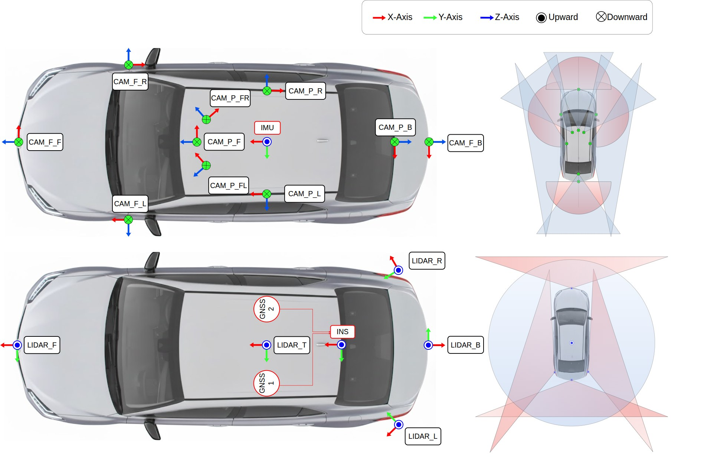

*Hình 3. Vị trí camera, LiDAR và vùng nhìn trên xe thu dữ liệu PHENIKAA (nguồn: [Phenikaa-X Perception Data](https://phenikaa-x.com/perception-data/)).*

Từ bảng trên, nhóm kết luận COMPLEX CITY và COMPLEX URBAN có đủ đầu vào để thử dựng cảnh 3DGS với cả pinhole lẫn fisheye bao quanh xe, nên sẽ dùng cho bước đánh giá PHENIKAA tuần sau. RESIDENTIAL AREA chỉ dùng được với 4 pinhole, 2 fisheye và LiDAR. Với cả ba chuỗi, việc đếm file mới cho biết dữ liệu có mặt; calibration và pose còn phải kiểm chứng (ví dụ chiếu LiDAR lên ảnh), và box vẫn chưa có ID theo dõi.

### 4.4 Việc còn mở từ tuần 02

Ba việc trong kế hoạch tuần 02 không có mục riêng ở trên; trạng thái của chúng nằm trong bảng ở mục 3. Phần dưới ghi những gì đã làm được cho từng việc:

- **Đánh giá trên đoạn đường giữ lại liền mạch:** đã đưa vào thiết kế benchmark ở mục 4.2. Split stereo của A1 cho ảnh thật lệch ngang khoảng 0,6 m, và danh sách đoạn xấu theo quãng đường đo được chỗ cảnh hỏng. Phần này chưa chạy.
- **Xử lý xe động và bầu trời:** đã giải quyết bằng cách dùng method OmniRe cho các run tuần này, không cần làm thêm. Hai vấn đề này gặp ở cấu hình dựng cảnh tĩnh của tuần 02 (xe động nhoè thành vệt; trời không có điểm LiDAR nên bị tô bằng Gaussian lơ lửng). OmniRe có sẵn cả hai phần: mỗi xe là một nhóm Gaussian riêng di chuyển theo box 3D qua từng khung, còn bầu trời do một mạng nhỏ riêng vẽ theo hướng nhìn, kèm mask trời để phạt Gaussian che vùng trời. Cột "PSNR xe" ở mục 5.1 và 5.2 đo riêng phần xe dựng tách ra này.
- **Chạy Instant NuRec:** đã thêm vào tool (mục 4.1). Ngoài tool, một thành viên đã chạy NuRec trên KITTI-360 và đưa cảnh vào CARLA; kết quả ở mục 5.5.

## 5. Kết quả thực nghiệm

Nhờ tool đã nâng cấp ở mục 4.1, tuần này nhóm chạy năm nhóm thực nghiệm, mỗi nhóm trả lời một câu hỏi. Ba nhóm đầu là dựng từng cảnh (per-scene optimization): chọn cấu hình trên camera pinhole (mục 5.1), gộp camera pinhole với fisheye (mục 5.2), và xử lý vùng mép ảnh fisheye (mục 5.3). Nhóm thứ tư thử các method cho quãng đường dài và một số method mới (mục 5.4). Nhóm thứ năm dựng cảnh bằng method feed-forward Instant NuRec và thử đưa cảnh đó vào CARLA (mục 5.5). Mỗi mục đi theo cùng trình tự: câu hỏi, vì sao cần, thiết lập, kết quả, nhận xét và mức tin cậy.

### 5.1 Dựng từng cảnh trên nuScenes (camera pinhole)

**Câu hỏi.** Trên camera pinhole, mỗi thành phần của cấu hình (method, renderer, luật densify, kỹ thuật tăng tốc) làm chất lượng ảnh và chi phí train thay đổi bao nhiêu?

**Vì sao cần.** Tool cho phép bật tắt nhiều thành phần, nên có hơn mười cấu hình chạy được. Trước khi chạy benchmark, nhóm cần biết thành phần nào nên giữ làm mặc định, và các kỹ thuật giảm chi phí như FastGS phải trả giá bao nhiêu PSNR. Câu hỏi về chi phí quan trọng vì các run chạy trên GPU T4 miễn phí của Kaggle, với quota giới hạn mỗi tuần.

**Thiết lập.** Nhóm dùng cảnh nuScenes scene-0061, là cảnh đầu tiên đã nạp và kiểm tra xong trong tool ở tuần 02; cảnh có 6 camera pinhole, có xe và người. Các run dùng 3 camera phía trước (split front3: 516 ảnh train, 57 ảnh test, cứ 10 khung lấy 1 khung làm test), ảnh 800×450, 30.000 bước, Kaggle T4. Mỗi phép so chỉ đổi một thành phần so với một run mốc, để chênh lệch kết quả quy về đúng thành phần đó.

| Run | Method | Renderer | Densify | FastGS | Faster-GS | PSNR | SSIM | LPIPS | PSNR xe | Train | VRAM | Gaussian |
|---|---|---|---|---|---|---|---|---|---|---|---|---|
| 8d9c | OmniRe | 3DGS | gốc | | có | 25,20 | 0,785 | 0,251 | 25,04 | 3 h 18 | 6,9 GB | 1,52 tr |
| 2d33 | OmniRe | 3DGS | gốc | | | 25,15 | 0,786 | 0,251 | 24,98 | 3 h 39 | 6,6 GB | 1,52 tr |
| 453a | OmniRe | 3DGS | gốc | có | | 25,02 | 0,777 | 0,268 | 24,73 | 2 h 47 | 4,4 GB | 0,55 tr |
| f8a6 | OmniRe | 3DGS | gốc | có | có | 25,01 | 0,778 | 0,269 | 24,75 | 2 h 29 | 4,7 GB | 0,55 tr |
| ccec | Street GS | 3DGS | gốc | có | | 25,02 | 0,779 | 0,264 | 24,48 | 1 h 11 | 3,4 GB | 0,43 tr |
| ecaa | Street GS | 3DGS | gốc | có | có | 24,96 | 0,779 | 0,264 | 24,38 | 1 h 03 | 3,7 GB | 0,43 tr |
| 60e5 | OmniRe | 3DGUT | gốc | có | có | 23,99 | 0,750 | 0,333 | 24,10 | 2 h 26 | 3,5 GB | 0,33 tr |
| a022 | OmniRe | 3DGS | MCMC | | có | 23,56 | 0,716 | 0,403 | 20,82 | 2 h 31 | 3,8 GB | 1,18 tr |
| 44d8 | OmniRe | 3DGUT | MCMC | | có | 23,19 | 0,711 | 0,415 | 20,21 | 2 h 39 | 3,6 GB | 1,18 tr |
| a8a9 | OmniRe | 3DGEER (densify 50 bước) | gốc | có | có | 21,77 | 0,752 | 0,300 | 24,46 | 2 h 43 | 4,3 GB | 0,54 tr |
| 6b85 | OmniRe | 3DGEER (densify 300 bước) | gốc | có | có | 21,66 | 0,744 | 0,317 | 24,42 | 2 h 34 | 3,6 GB | 0,44 tr |

Hai hình dưới đặt ảnh render của các cấu hình cạnh ảnh thật, cùng một khung test của camera CAM_FRONT. Số trong ngoặc là PSNR trên toàn tập test của run đó, không phải của riêng khung này. Hình 4 so ảnh thật với ba cấu hình tốt nhất; Hình 5 giữ cấu hình mốc và mỗi ô chỉ đổi một thành phần.

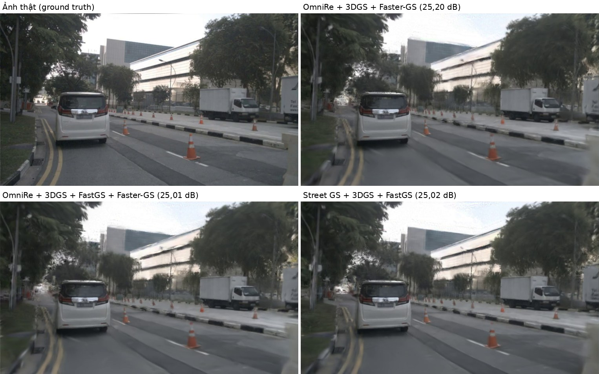

*Hình 4. Ảnh thật và ba cấu hình tốt nhất trên nuScenes scene-0061 (CAM_FRONT, cùng khung test).*

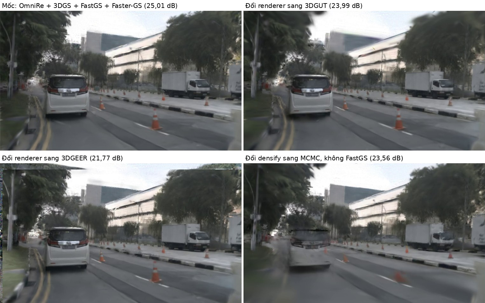

*Hình 5. Cấu hình mốc và ba cấu hình chỉ đổi một thành phần (cùng khung test).*

Trên ảnh, ba cấu hình tốt nhất gần như không phân biệt được với nhau, khớp với mức chênh dưới 0,2 dB. Ở Hình 5, MCMC làm chiếc xe phía trước nhoè thành khối mờ và cọc giao thông mất hình dạng, khớp với việc vùng xe kém 4,2 dB. 3DGEER giữ được xe nhưng có một dải nhiễu ở mép trái và một khung chữ nhật lệch ở mép trên ảnh.

So từng cặp run trong bảng, nhóm rút ra các nhận xét sau:

- **Thêm FastGS** (453a so với 2d33): model cuối nhỏ khoảng 2,8 lần (0,55 so với 1,52 triệu Gaussian), train nhanh hơn khoảng 25% và tốn ít VRAM hơn khoảng 30%, trong khi PSNR chỉ kém 0,13 dB. **Thêm Faster-GS** (8d9c so với 2d33) chỉ làm train nhanh hơn, PSNR gần như không đổi.
- **Đổi method** (ccec so với 453a, cùng 3DGS và FastGS): Street GS cho PSNR ngang OmniRe (25,02 dB) và train nhanh gấp khoảng 2 lần. Tuy nhiên vùng người kém 1,2 dB (22,94 so với 24,15), vì Street GS không có node SMPL để dựng người.
- **Đổi renderer** (60e5 và a8a9 so với f8a6): 3DGUT kém 3DGS 1,0 dB, chủ yếu vì densify ít nên có ít hơn 40% Gaussian; 3DGEER kém 3,2 dB dù có cùng số Gaussian nền, và densify dày hơn (mỗi 50 bước thay vì 300) chỉ cải thiện 0,1 dB. Mỗi renderer giữ thông số densify riêng theo config của nó, nên đây là so hai cấu hình hoàn chỉnh chứ không chỉ riêng cách vẽ.
- **Đổi luật densify sang MCMC** (a022 so với 8d9c): kém 1,6 dB, và vùng xe tụt mạnh nhất (20,82 so với 25,04 dB). Vì vậy từ 19/11 nhóm gỡ MCMC khỏi lựa chọn mặc định của OmniRe.
- **Số bước:** khi có FastGS, 3DGUT và 3DGEER gần như đạt chất lượng cuối ở bước 15.000; từ đó tới 30.000 bước chỉ tăng thêm 0,1–0,3 dB.

**Mức tin cậy.** Mỗi cấu hình chỉ chạy một lần, nên chênh lệch dưới khoảng 0,1 dB (ví dụ 8d9c với 2d33) chưa đủ để kết luận. Kết quả mới đúng cho một cảnh nuScenes và camera pinhole. Từ kết quả này, các run KITTI-360 ở mục 5.2 dùng FastGS và Faster-GS để giảm chi phí, và không dùng MCMC.

### 5.2 Gộp camera pinhole và fisheye trên KITTI-360

**Câu hỏi.** Có hai câu hỏi. Thứ nhất, ảnh pinhole và ảnh fisheye có học chung được một cảnh 3D không, hay thêm ảnh pinhole làm ảnh fisheye kém đi? Thứ hai, trong hai renderer vẽ được ảnh fisheye, 3DGUT và 3DGEER, cái nào tốt hơn?

**Vì sao cần.** Dữ liệu đích của dự án có cả camera pinhole và fisheye (mục tiêu đặt ra ở tuần 01). Renderer 3DGS chỉ vẽ được pinhole, nên muốn dùng ảnh fisheye thì phải chọn giữa 3DGUT và 3DGEER.

**Thiết lập và lý do chọn.**

- **Dữ liệu:** KITTI-360 drive_0003, khung 0–199 (khoảng 20 giây). KITTI-360 là bộ công khai nhóm có, gồm cả 2 camera pinhole, 2 camera fisheye, LiDAR, pose và box 3D.
- **Cấu hình:** OmniRe + FastGS + Faster-GS. Nhóm chọn OmniRe vì method này tách xe động theo box 3D và KITTI-360 có box cho xe. FastGS và Faster-GS được bật vì mục 5.1 cho thấy chúng giảm thời gian train và VRAM mà chỉ mất khoảng 0,2 dB, điều cần thiết khi chạy nhiều run trên T4. MCMC tắt vì kém 1,6 dB ở mục 5.1.
- **Hai bộ camera train:** chỉ 2 camera fisheye (362 ảnh train, 38 ảnh test), và cả 4 camera (724 ảnh train, 76 ảnh test). Ảnh fisheye giữ nguyên phép chiếu fisheye ở 700×700; ảnh pinhole dùng 704×188. Hai bộ train cùng 30.000 bước, nên run gộp học mỗi ảnh ít lần hơn.
- **Khác biệt cần lưu ý:** mỗi renderer giữ thông số densify riêng (3DGUT densify mỗi 100 bước với ngưỡng 0,0005; 3DGEER mỗi 50 bước với ngưỡng 0,01), nên so 3DGUT với 3DGEER là so hai cấu hình hoàn chỉnh.
- Kaggle T4, protocol đánh giá 0.3, chạy ngày 17/11. Ảnh fisheye được che các pixel lệch trục quang quá 83°.

| Run | Renderer | Camera train | PSNR | SSIM | LPIPS | PSNR xe | Gaussian | Train | VRAM | FPS |
|---|---|---|---|---|---|---|---|---|---|---|
| 146b | 3DGUT | 2 fisheye | 23,08 | 0,760 | 0,224 | 22,74 | 272k | 2 h 16 | 3,1 GB | 11,3 |
| e3e3 | 3DGEER | 2 fisheye | 22,90 | 0,746 | 0,220 | 22,20 | 194k | 2 h 30 | 3,5 GB | 11,3 |
| e627 | 3DGUT | 2 pinhole + 2 fisheye | 23,72 | 0,769 | 0,234 | 21,14 | 208k | 1 h 37 | 3,1 GB | 14,9 |
| 0b27 | 3DGEER | 2 pinhole + 2 fisheye | 21,37 | 0,765 | 0,214 | 21,45 | 218k | 2 h 01 | 3,4 GB | 12,9 |

PSNR chung trộn lẫn các camera, nên bảng dưới tách PSNR theo từng camera để thấy chênh lệch đến từ đâu (ô trống là camera không dùng trong run đó):

| Camera | 146b 3DGUT, chỉ fisheye | e3e3 3DGEER, chỉ fisheye | e627 3DGUT, gộp | 0b27 3DGEER, gộp |
|---|---|---|---|---|
| image_00 pinhole | | | 25,74 | 20,15 |
| image_01 pinhole | | | 25,09 | 19,95 |
| image_02 fisheye | 23,83 | 23,23 | 23,04 | 23,89 |
| image_03 fisheye | 22,33 | 22,57 | 21,00 | 21,48 |

Hai hình dưới đặt ảnh render cạnh ảnh thật ở cùng một khung test. Hình 6 so hai renderer trên camera fisheye image_02 của hai run chỉ train fisheye. Hình 7 so hai renderer trên camera pinhole image_00 của hai run gộp, là nơi có khoảng cách 5,6 dB.

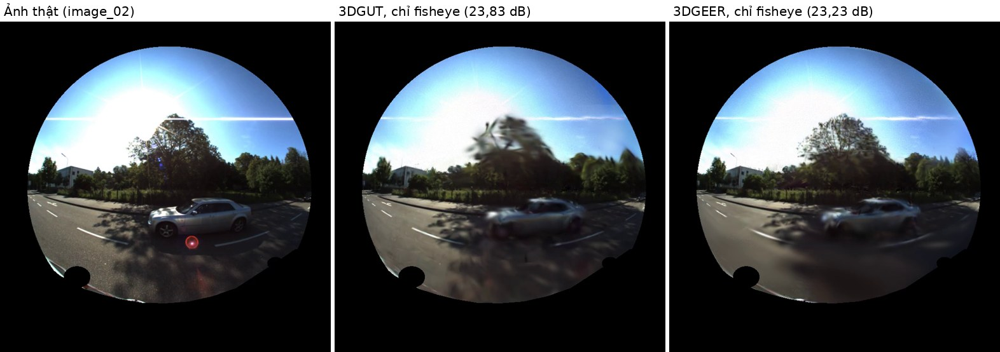

*Hình 6. Camera fisheye image_02: ảnh thật, 3DGUT và 3DGEER (run chỉ train fisheye, cùng khung test; số là PSNR của camera này trên toàn tập test).*

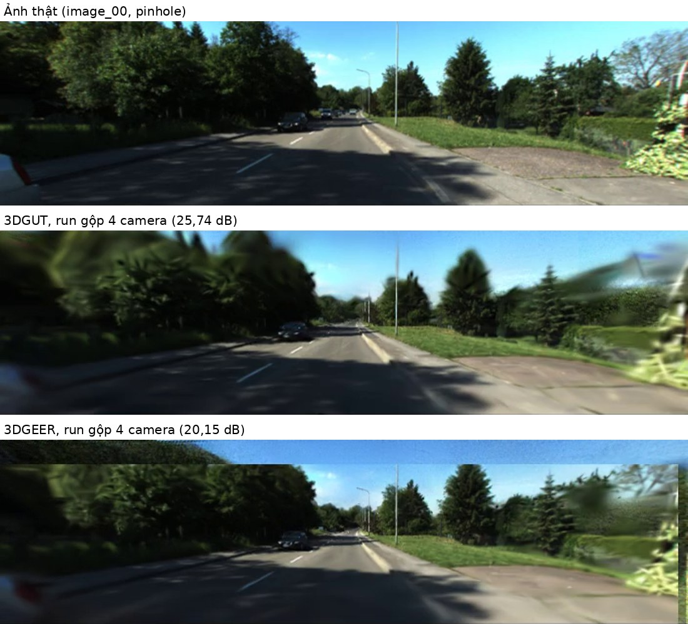

*Hình 7. Camera pinhole image_00 trong run gộp 4 camera: ảnh thật, 3DGUT và 3DGEER (cùng khung test).*

Trên ảnh fisheye, hai renderer cho kết quả tương tự nhau, đều nhoè ở xe đang chạy và ở tán cây sát mặt trời. Trên ảnh pinhole, ảnh 3DGEER có một khung chữ nhật lệch so với ảnh thật ở mép trên và mép phải, giống hiện tượng ở mép ảnh 3DGEER trên nuScenes (Hình 5). Hiện tượng này gợi ý vấn đề nằm ở phép chiếu pinhole của 3DGEER chứ không chỉ do gộp camera, nhưng cần đợt chạy chỉ train pinhole để khẳng định.

Từ hai bảng trên, nhóm rút ra các nhận xét sau:

- **Trên ảnh fisheye, hai renderer ngang nhau.** Khi chỉ train fisheye, 3DGUT hơn 0,18 dB và mỗi renderer thắng một camera. Trong run gộp, 3DGEER còn hơn 3DGUT trên cả hai camera fisheye (0,85 và 0,48 dB).
- **Khoảng cách 2,35 dB của run gộp nằm hết ở camera pinhole:** 3DGEER chỉ đạt khoảng 20 dB trên image_00 và image_01, thấp hơn 3DGUT khoảng 5,3 dB.
- **Gộp pinhole không làm hỏng fisheye:** PSNR fisheye của run gộp gần bằng run chỉ train fisheye. Với 3DGEER, image_02 còn tăng 0,66 dB; image_03 giảm 1,1–1,3 dB ở cả hai renderer.
- **Chi phí:** 3DGUT train nhanh hơn và tốn ít VRAM hơn ở cả hai bộ camera.

**Mức tin cậy và việc còn mở.** Mỗi cấu hình chạy một lần. Nhóm chưa chạy bộ chỉ train pinhole, nên chưa biết 3DGEER kém trên pinhole do chính phép chiếu pinhole của nó hay do gộp hai loại camera. Đợt chạy này nằm trong bước 3 của benchmark (cảnh A2, mục 7).

### 5.3 Vùng mép ảnh fisheye và giới hạn 90° của renderer

**Câu hỏi.** Vì sao PSNR ở vùng mép ảnh fisheye thấp, và nên che ảnh fisheye tới góc nào khi train?

**Vì sao cần.** Ống kính fisheye của KITTI-360 nhìn tới 96,1° lệch khỏi trục quang ở image_02 và 92,5° ở image_03. Các run ở mục 5.2 che mọi pixel lệch trục quá 83°, tức là bỏ một vành ảnh rộng khi train. Nếu renderer vẽ được vành đó thì nới vùng che sẽ cho cảnh thêm dữ liệu; nếu không vẽ được thì train vành đó chỉ thêm nhiễu.

**Kết quả.** Nhóm trả lời câu hỏi qua ba bước, mỗi bước dựa trên kết quả của bước trước.

**Bước 1. Đo theo dải góc trên các run ở mục 5.2.** Nhóm render lại checkpoint của 146b (3DGUT) và e3e3 (3DGEER) mà không che, rồi so với ảnh gốc theo từng dải góc trên 12 khung của image_02. Ngoài 83°, cả hai renderer tụt như nhau (88–89°: 17,4 dB cả hai; 89–90°: 16,5 và 16,6 dB). Vì vậy phần tụt do vành ảnh này chưa được học khi train, chứ không do renderer vẽ sai.

**Bước 2. Nới vùng che từ 83° lên 88°.** Hai run thử 4ef4 và fe92 cùng dùng OmniRe + 3DGUT, 1.000 bước, cảnh 40 khung với 2 camera fisheye, và chỉ khác góc che. Bảng dưới đo trên 8 khung test của image_02. Vành 83–90° tăng thêm 1,2–2,4 dB và dải 60–83° gần như không đổi, nhưng dải giữa ảnh 0–60° giảm 0,5 dB. Với một run 1.000 bước, chưa rõ mức giảm 0,5 dB này là do vùng che hay do dao động giữa hai lần chạy.

| Dải góc | Che từ 83° (4ef4) | Che từ 88° (fe92) |
|---|---|---|
| 0–60° | 19,5 dB | 19,0 dB |
| 60–83° | 18,3–20,8 dB | 18,4–20,9 dB |
| 83–86° | 16,2 dB | 17,4 dB |
| 86–88° | 14,8 dB | 17,2 dB |
| 88–90° | 13,9 dB | 16,1 dB |

**Bước 3. Thử che tới đúng giới hạn ống kính.** Run `3586` (3DGEER) che tới đúng giới hạn ống kính (96,1° và 92,5°). Kết quả: mô hình có độ phủ (opacity) bằng 0 ở mọi pixel lệch trục quá 90°, tức là không vẽ được gì ở đó. Đọc code của gsplat cho thấy nguyên nhân: gsplat bỏ mọi Gaussian có tâm nằm sau mặt phẳng camera, và điều này đúng cho cả 3DGUT lẫn 3DGEER. Vì run này train một vành ảnh mà renderer không vẽ được, nhóm không dùng nó để so PSNR.

Từ ba bước trên, từ 19–20/11 nhóm che các pixel lệch trục quá 88° cho cả hai renderer, tức là giữ góc nhìn 176°. Mức 88° nằm sát giới hạn 90° và chừa 2° an toàn, vì 3DGUT chiếu các điểm mẫu của mỗi Gaussian qua ống kính và phép chiếu này đã sai lệch khi tới gần 90°. Vành 88–96° vẫn bị bỏ, vì renderer hiện tại không vẽ được.

Sau khi đặt vùng che 88°, nhóm kiểm tra thêm một câu hỏi phụ: 3DGEER tính giao giữa tia sáng và Gaussian một cách chính xác, nên được kỳ vọng vẽ vùng mép tốt hơn 3DGUT. Hai run thử dưới đây giữ mọi điều kiện như nhau và chỉ đổi renderer: cảnh 40 khung, 2 camera fisheye, 1.000 bước, cùng che từ 88°.

| | fe92 3DGUT | d9ee 3DGEER |
|---|---|---|
| PSNR image_02 / image_03 | 19,27 / 18,18 | 18,79 / 17,47 |
| LPIPS image_02 / image_03 | 0,362 / 0,345 | 0,361 / 0,343 |
| PSNR image_02 theo dải góc 0–60° / 60–88° / 88–96° | 19,00 / 17,2–20,9 / 13,2–16,1 | 19,11 / 15,5–19,4 / 10,6–15,0 |
| Số Gaussian cuối | 1,05 triệu | 1,34 triệu |

Hình 8 đặt ảnh render của ba run thử cạnh ảnh thật, cùng một khung test. Vì chỉ train 1.000 bước, cả ba ảnh còn nhoè; hình chỉ dùng để xem vùng mép và các vết lỗi.

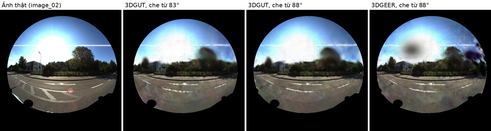

*Hình 8. Camera fisheye image_02, run thử 1.000 bước: ảnh thật, 3DGUT che từ 83°, 3DGUT che từ 88°, 3DGEER che từ 88° (cùng khung test).*

Ở run che từ 88°, vành ngoài của ảnh có thêm hình mặt đường và hàng cây mà run che từ 83° còn thiếu. Ảnh 3DGEER có một vết tối giữa bầu trời và các vết tím ở mép phải, khớp với việc 3DGEER kém nhiều nhất ở dải 60–88°.

Kết quả không như kỳ vọng: 3DGEER kém 3DGUT 0,5–0,7 dB, kém nhiều nhất ở dải 60–88°, tức chính vùng mép. Ngoài 88° cả hai đều tụt mạnh vì không vẽ được gì ngoài màu trời.

**Mức tin cậy.** Hai run này chỉ chạy 1.000 bước trên cảnh 40 khung, mỗi cấu hình một lần, trong khi các run 30.000 bước ở mục 5.2 cho thấy hai renderer ngang nhau trên fisheye. Vì vậy kết quả này chưa đủ để nói 3DGEER kém trên fisheye khi train đầy đủ.

**Run đầy đủ đầu tiên với vùng che 88°.** Để biết vùng che mới có giữ được chất lượng khi train đủ 30.000 bước, nhóm chạy lại cấu hình của 146b (OmniRe + 3DGUT + FastGS + Faster-GS, 2 camera fisheye, cùng đoạn khung 0–199) trên bản nạp mới của cảnh, có vùng che 88° tính theo từng camera. Run này là 82bc, xong ngày 21/11.

| | 146b (che từ 83°) | 82bc (che từ 88°) |
|---|---|---|
| PSNR / SSIM / LPIPS | 23,08 / 0,760 / 0,224 | 22,84 / 0,763 / 0,223 |
| PSNR image_02 / image_03 | 23,83 / 22,33 | 23,27 / 22,41 |
| Gaussian, thời gian train, VRAM (GiB = `peak_vram_mb / 1024`) | 272k, 2 h 16, 3,0 GiB | 266k, 1 h 59, 3,0 GiB |

PSNR chung thấp hơn 0,24 dB, còn SSIM và LPIPS gần như không đổi. Tuy vậy hai con số không đo trên cùng một tập pixel: 82bc tính thêm vành 83–88°, là vùng khó hơn phần giữa ảnh (mục Bước 2 ở trên). Vì vậy chênh lệch này chưa cho biết vùng che 88° làm phần giữa ảnh tốt lên hay kém đi. Để trả lời, nhóm cần đo hai run theo cùng các dải góc như ở Bước 2; việc này cần ảnh render của 82bc. Cập nhật 28/11/2026: artifact của run đã tải đủ về máy;
việc đo lại theo cùng dải góc chưa được thực hiện.

### 5.4 Quãng đường dài (long-drive) và các method khác

**Câu hỏi.** Có method nào có code mà dựng được một đoạn đường từ 1 km trở lên trên một GPU T4 không, và method nào nên đưa vào track B (quãng đường dài) của benchmark? Ngoài ra, các method mới (BezierGS, SimULi, SplatAD) có tái hiện được kết quả của paper để đưa vào tool không?

**Vì sao cần.** Mục tiêu của dự án là mô phỏng closed-loop trên một khu vực thật, nhưng các run tới tuần 02 mới dựng đoạn 4–30 giây (quyết định ở tuần 02). Vì vậy nhóm cần biết hướng nào đi được tới cỡ km.

**Thiết lập.** Mỗi method chạy trên một dataset có số liệu trong paper của nó, để so được với paper: KITTI Odometry 06 cho các method SLAM một camera, Waymo cho MCGS-SLAM và BezierGS, NCore cho SimULi, PandaSet cho SplatAD. Vì dữ liệu khác nhau, các con số dưới đây chỉ so được với paper của chính method đó, không so được giữa các method. Ngoài ra PSNR của SLAM đo trên keyframe, tức là ảnh đã dùng để học, nên cũng không so được với PSNR test ở mục 5.1.

| Method | Dữ liệu | Trạng thái | PSNR / SSIM / LPIPS | Khác | Chi phí (T4) |
|---|---|---|---|---|---|
| KiloGS-SLAM | KITTI 06 đủ 1.101 khung, ~1,2 km, 1 camera | Xong | 21,99 / 0,666 / 0,482 (keyframe) | ATE 1,37 m, scale 0,97; loop closure bắt 6 vòng; 236k anchor | 39,9 phút, VRAM 14,4 GB |
| MCGS-SLAM | Waymo 100613, 3 camera, 198 khung, ~19 s | Xong | 26,81 / 0,821 / 0,240 (keyframe; paper TB 26,50) | ATE 1,19 m (paper 1,30); 172k Gaussian, `.ply` 11,7 MB | 17,4 phút, 8,9 GB |
| BezierGS | Waymo 017, 3 camera, 49 khung, 640×960 | Xong | Test 29,91 / 0,894 / 0,082; Dyn-PSNR 30,60 (paper TB 12 cảnh: 31,51 / 0,903 / 0,092 / 28,51) | 1,87 triệu Gaussian; `.ply` nền 1,80 triệu, 68% gần trong suốt | 169,5 phút, 10,9 GB |
| SimULi | NCore clip 004c2001 | Dừng | | Loss LiDAR NaN sau 40–340 bước do lỗi render LiDAR có feature của gsplat 1.6 | |
| GigaSLAM, GLAM-SLAM | KITTI 06 | Dừng | | Không cải thiện so với KiloGS/MCGS-SLAM | |
| SplatAD, IDsplat | PandaSet 001 | Đang làm | | | |

Hai điểm rút ra cho track B của benchmark (quãng đường dài):

- KiloGS-SLAM cho thấy 1,2 km vừa đủ chạy trên một GPU T4, và sai số quỹ đạo tốt hơn số của paper GigaSLAM trên cùng chuỗi (2,11 m). Tuy nhiên PSNR chỉ khoảng 22 dB, method chỉ dùng 1 camera, không mô hình hoá xe động, và lưu bản đồ dạng anchor + MLP chứ không phải `.ply` 3DGS thuần.
- Nhóm chưa tìm được method nào có code mà vừa chạy được cỡ km vừa render được xe động. Vì vậy track B ưu tiên cách chia đoạn đường thành nhiều đoạn ngắn (chunk), dựng từng đoạn bằng method của drivestudio, rồi gộp lại.

**Mức tin cậy.** Mỗi method chạy một lần trên một chuỗi. Các số so với paper chỉ cho biết nhóm đã chạy đúng method, chưa cho biết method đó tốt trên dữ liệu của dự án.

### 5.5 Dựng tức thì (feed-forward) bằng Instant NuRec và thử đưa cảnh vào CARLA

**Câu hỏi.** Có hai câu hỏi. Thứ nhất, Instant NuRec có dựng được cảnh từ dữ liệu KITTI-360 của dự án không, và chất lượng ra sao? Thứ hai, cảnh tái dựng có đưa vào CARLA được không, tức là CARLA chạy xe trong cảnh đó và cảnh được render theo vị trí camera của CARLA?

**Vì sao cần.** Instant NuRec là method được chọn cho hướng feed-forward ở tuần 02, nay là track C (feed-forward) của benchmark. Còn việc đưa cảnh vào CARLA là mục tiêu cuối của dự án: ở tuần 01, nhóm mới phân tích trên giấy cách NVIDIA nối NuRec với CARLA (một script gọi cả hai bên, mỗi bước mô phỏng lấy vị trí camera từ CARLA rồi gọi renderer).

**Thiết lập.** Một thành viên làm thử nghiệm này ngoài tool drive2sim, ngày 16/11, theo ba bước nối tiếp nhau:

1. **Chuyển dữ liệu sang định dạng NuRec đọc được.** NuRec chỉ đọc dữ liệu ở định dạng NCore của NVIDIA, nên KITTI-360 chuỗi 0003 được chuyển sang NCore. Để kiểm tra phép chuyển đúng, điểm LiDAR được chiếu lên ảnh của cả 4 camera (Hình 9), và mask thân xe được làm thử hai phiên bản.
2. **Dựng cảnh bằng NuRec.** NuRec được chạy trước trên clip mẫu của NVIDIA để kiểm tra method chạy được, rồi trên KITTI-360 với cả 4 camera (2 pinhole, 2 fisheye) ở hai độ dài: 40 khung và 150 khung, bắt đầu từ khung 167. Đầu ra là một file `.ply` cảnh tĩnh, kèm phần trời lưu riêng.
3. **Đưa cảnh vào CARLA.** Cảnh NuRec được render theo camera của một xe chạy trong CARLA suốt 75 giây, và 4 xe NPC (xe do CARLA điều khiển) được ghép vào ảnh render (Hình 11).

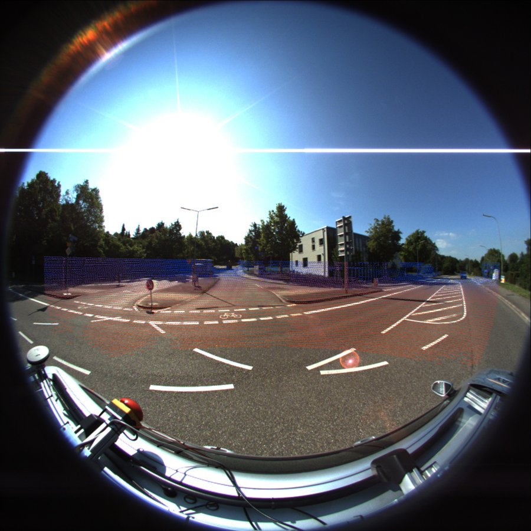

*Hình 9. Kiểm tra dữ liệu sau khi chuyển sang NCore: điểm LiDAR (đỏ gần, xanh xa) chiếu lên ảnh fisheye image_02 nằm khít mặt đường và tường nhà.*

**Kết quả.** Bảng dưới là PSNR theo từng camera mà NuRec đạt trên KITTI-360:

| Camera | 40 khung (10 ảnh đo mỗi camera) | 150 khung (15 ảnh đo mỗi camera) |
|---|---|---|
| image_00 pinhole | 15,98 | 15,89 |
| image_01 pinhole | 16,07 | 15,88 |
| image_02 fisheye | 16,02 | 15,52 |
| image_03 fisheye | 16,19 | 13,71 |

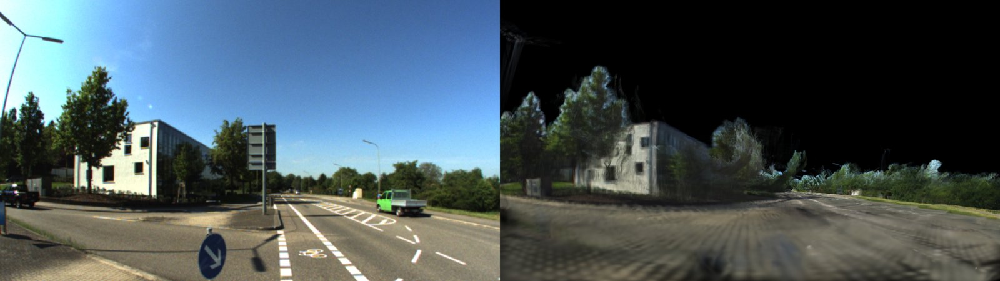

*Hình 10. Instant NuRec trên KITTI-360 (40 khung), camera fisheye image_02: ảnh thật (trái) và ảnh render (phải).*

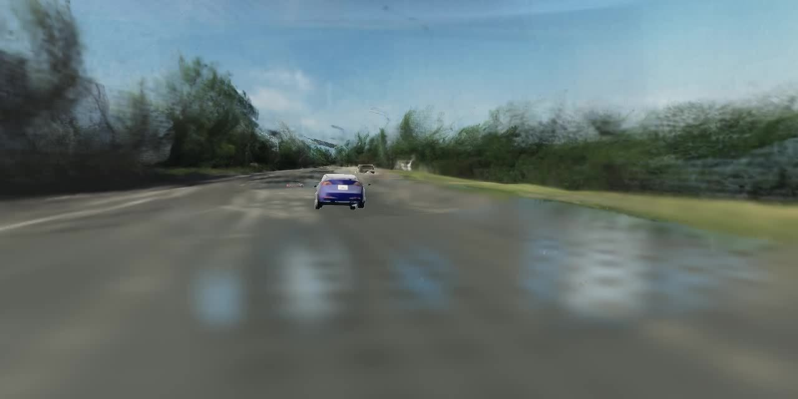

*Hình 11. Cảnh NuRec chạy trong CARLA: nền là cảnh tái dựng, xe màu xanh là xe NPC của CARLA được ghép vào ảnh.*

Từ bảng và các hình trên, nhóm rút ra các nhận xét sau:

- **Bước chuyển dữ liệu đúng:** điểm LiDAR nằm khít lên vật trong ảnh ở cả camera pinhole lẫn fisheye, nên NuRec nhận đúng calibration và pose của KITTI-360.
- **NuRec chạy được trên dữ liệu của dự án, nhưng chất lượng còn thấp:** PSNR khoảng 16 dB ở mọi camera. Hình 10 cho thấy ba nguyên nhân nhìn thấy được. Bầu trời bị đen hoàn toàn, vì ảnh đo không ghép phần trời lưu riêng; vùng trời chiếm khoảng một phần ba ảnh nên kéo PSNR xuống mạnh. Mặt đường bị nhoè thành vân ô lưới. Xe đang chạy (xe tải xanh ở ảnh thật) không có trong ảnh render, vì `.ply` của NuRec chỉ chứa cảnh tĩnh.
- **Dài hơn thì kém hơn:** với 150 khung, PSNR giảm nhẹ ở ba camera và giảm 2,5 dB ở fisheye image_03. Nhóm chưa tìm hiểu nguyên nhân.
- **Đưa vào CARLA được:** đây là lần đầu dự án chạy được một cảnh tái dựng trong CARLA, với xe NPC của CARLA chạy trên đường của cảnh. Trong video CARLA, phần trời đã được ghép vào. Tuy nhiên mặt đường và hai bên đường vẫn nhoè như ở Hình 10.

**Mức tin cậy và câu hỏi còn mở.** Các con số trên chưa so được với các run OmniRe ở mục 5.1 và 5.2 (khoảng 23 dB), vì khác đoạn khung (40 hoặc 150 khung so với 200 khung), khác cách chọn ảnh đo, và tính cả vùng trời đen. Nhóm còn bốn điểm phải xác nhận với thành viên đã chạy (ghi ở mục 8): PSNR đo trên ảnh NuRec đã nhận làm đầu vào hay ảnh giữ lại; vì sao ảnh đo không ghép trời; video CARLA là chạy lại theo quỹ đạo ghi sẵn hay CARLA điều khiển xe; và xe NPC được ghép vào ảnh có che khuất đúng theo độ sâu không. Để so được với các method khác, NuRec cần chạy qua bộ đo chung của benchmark (track C, mục 7).

## 6. Phát hiện và quyết định

Mục này gồm hai phần. Phần đầu gom các nhận xét ở mục 5.1–5.3 thành kết luận: nên dùng cấu hình nào cho trường hợp nào. Phần sau là các quyết định khác cho benchmark tuần tới.

**Cấu hình khuyến nghị theo trường hợp.** Các run ở mục 5.1 và 5.2 mỗi lần chỉ đổi một thành phần, nên có thể ghép lại thành lựa chọn cho từng trường hợp. Faster-GS được bật ở mọi trường hợp, vì nó chỉ làm train nhanh hơn mà không đổi chất lượng (8d9c so với 2d33).

*Ghi chú: mỗi dòng là một trường hợp sử dụng; cột "Đánh đổi" ghi cái giá phải trả so với cấu hình khác. Kết luận mới dựa trên một cảnh nuScenes (pinhole) và một cảnh KITTI-360 (fisheye), mỗi cấu hình chạy một lần; benchmark tuần sau sẽ kiểm tra lại trên cảnh A1, A2.*

| Trường hợp | Cấu hình khuyến nghị | Vì sao | Đánh đổi | Nguồn |
|---|---|---|---|---|
| Chỉ có camera pinhole, dùng làm mặc định (ô A-LB của benchmark) | OmniRe + 3DGS + FastGS + Faster-GS | 25,01 dB, chỉ kém cấu hình tốt nhất 0,19 dB; số Gaussian ít hơn 2,8 lần nên file `.ply` nhỏ; train 2 h 29 thay vì 3 h 18; VRAM 4,7 thay vì 6,9 GB | Mất khoảng 0,2 dB | Mục 5.1 (Dựng từng cảnh trên nuScenes) |
| Chỉ có camera pinhole, cần chất lượng cao nhất và GPU dư VRAM | OmniRe + 3DGS + Faster-GS | PSNR cao nhất, 25,20 dB | Train lâu nhất (3 h 18), 6,9 GB VRAM, 1,52 triệu Gaussian | Mục 5.1 |
| Chỉ có camera pinhole, cảnh ít hoặc không có người, cần train nhanh | Street GS + 3DGS + FastGS | PSNR ngang OmniRe (25,02 dB), train nhanh gấp khoảng 2 lần (1 h 11) | Vùng người kém 1,2 dB, vì Street GS không dựng người bằng SMPL | Mục 5.1 |
| Có camera fisheye (chỉ fisheye, hoặc gộp pinhole với fisheye) | OmniRe + 3DGUT + FastGS + Faster-GS, che pixel fisheye lệch trục quá 88° | Ngang 3DGEER trên ảnh fisheye; hơn 3DGEER 2,35 dB khi gộp pinhole; train nhanh hơn và ít VRAM hơn | Trên ảnh pinhole, 3DGUT kém 3DGS 1,0 dB; nếu cảnh chỉ có pinhole thì dùng 3DGS | Mục 5.2, 5.3 |
| Không nên dùng | Luật densify MCMC; renderer 3DGEER cho ảnh pinhole | MCMC kém 1,6 dB và vùng xe kém 4,2 dB; 3DGEER kém 3DGS 3,2 dB trên pinhole | | Mục 5.1 |

**Các quyết định khác.** Từ các kết quả ở mục 5 và việc chọn dataset ở mục 4.3, nhóm chốt thêm các quyết định sau cho benchmark tuần tới.

*Ghi chú: các quyết định chốt trong tuần, mỗi quyết định kèm lý do và nguồn (mục trong báo cáo, paper hoặc tài liệu).*

| Quyết định | Lý do / bằng chứng | Nguồn |
|---|---|---|
| Bỏ KiloGS-SLAM khỏi benchmark, dùng MCGS-SLAM cho track B (quãng đường dài) | KiloGS PSNR thấp (~22 dB) và chỉ 1 camera; MCGS dùng nhiều camera, khớp số paper | Mục 5.4 (Quãng đường dài và các method khác) |
| Track B (quãng đường dài) ưu tiên chia chunk rồi gộp trên drivestudio | Chưa có method có code vừa chạy cỡ km vừa render xe động | Mục 5.4 (Quãng đường dài và các method khác) |
| Dừng SimULi | Loss LiDAR NaN do lỗi render LiDAR của gsplat 1.6 | Mục 5.4 (Quãng đường dài và các method khác) |
| 3DGUT là renderer mặc định cho camera fisheye | Ngang 3DGEER trên ảnh fisheye, tốt hơn 2,35 dB khi gộp pinhole, train nhanh hơn và tốn ít VRAM hơn | Mục 5.2 (Gộp camera pinhole và fisheye trên KITTI-360) |
| Che các pixel fisheye lệch trục quang quá 88° (giữ góc nhìn 176°) cho cả hai renderer | Renderer không vẽ được gì ngoài 90° (gsplat bỏ Gaussian sau mặt phẳng camera); nới từ 83° lên 88° tăng vùng mép 1,2–2,4 dB | Mục 5.3 (Vùng mép ảnh fisheye và giới hạn 90°) |
| Gỡ luật densify MCMC khỏi lựa chọn mặc định của OmniRe | Kém 1,6 dB, vùng xe tụt mạnh nhất | Mục 5.1 (Dựng từng cảnh trên nuScenes) |
| Loại A2D2 | Không có ego pose và box 3D trong chuỗi liên tục | Mục 4.3 (Dataset) |
| Đánh giá PHENIKAA cho track A (dựng từng cảnh), bắt đầu với hai chuỗi mini COMPLEX CITY và COMPLEX URBAN | Bộ duy nhất tìm được có 4 fisheye bao quanh, LiDAR, box và pose; hai chuỗi này đủ cả 10 camera | Mục 4.3 (Dataset); [Phenikaa-X Perception Data](https://phenikaa-x.com/perception-data/) |
| Benchmark 3 track xếp hạng riêng (dựng từng cảnh, quãng đường dài, feed-forward), 13 run ưu tiên | Cần đo 8 yêu cầu của closed-loop, không chỉ PSNR nội suy | Mục 4.2 (Thiết kế benchmark); EUVS (ICCV 2025), XLD (3DV 2025), Para-Lane (2025) |

## 7. Kế hoạch tuần sau

Benchmark đã thiết kế xong, nên tuần sau nhóm dựng tool đo theo thiết kế đó và chạy các run ưu tiên. Song song, nhóm đánh giá PHENIKAA để biết bộ này có thay được KITTI-360 cho track A (dựng từng cảnh) không.

{{ke-hoach}}

### Ma trận chạy benchmark tuần 04

Việc "Chạy benchmark theo ma trận" ở bảng trên gồm 13 run. Bảng dưới liệt kê các run đó theo thứ tự chạy: bước 1 của track A (dựng từng cảnh) chạy trước, vì cần method thắng ở bước này để làm các bước sau.

*Ghi chú: chi tiết của việc "Chạy benchmark theo ma trận" trong bảng kế hoạch mục 7; các run ưu tiên 1 xếp theo thứ tự chạy, GPU-giờ ước lượng trên một RTX 4090. Thiết kế benchmark ở mục 4.2 (Thiết kế benchmark).*

| Thứ tự | Track benchmark, bước | Method hoặc cấu hình | Scene | Số run | GPU-giờ |
|---|---|---|---|---|---|
| 1 | A, chọn best A-LB (có LiDAR, có box) | OmniRe + 3DGS + FastGS | A1 | 1 | 1,2 |
| 1 | A, chọn best A-L (có LiDAR, không box) | PVG; DeformableGS | A1 | 2 | 3,4 |
| 2 | A, A-0 (không LiDAR, không box) | Method thắng A-L, bỏ LiDAR | A1 | 1 | 1,7 |
| 3 | A, chọn renderer fisheye | OmniRe + 3DGUT; OmniRe + 3DGEER | A2 | 2 | 4,3 |
| 3 | A, fisheye cho A-L | A-L với 3DGUT | A2 | 1 | 2,0 |
| Song song | B (quãng đường dài) | MCGS-SLAM | B2 | 1 | 0,5 |
| Song song | C (feed-forward) | Instant NuRec | Clip mẫu NCore, A1 | 2 | 3,0 |
| Chung | Hiệu chỉnh | 3k bước | A1, A2 | 1 | 1,0 |
| Cuối | A, cảnh thứ hai | Method thắng A-LB | A3 | 1 | 1,2 |
| Cuối | B (quãng đường dài) | drivestudio chia chunk + gộp | B2 (5–7 chunk) | 1 | 5,0 |
| **Tổng ưu tiên 1** | | | | **13** | **~23** |

Nếu còn thời gian, nhóm chạy thêm BezierGS, SplatAD, NuRec trên B2, ReconDrive và EVolSplat4D (6 run, khoảng 7 GPU-giờ).

## 8. Hạn chế, rủi ro và câu hỏi còn mở

Phần này gồm hai nhóm: các giới hạn đã biết trước của benchmark tuần sau, và các câu hỏi về thử nghiệm Instant NuRec ở mục 5.5 cần thành viên đã chạy xác nhận.

**Giới hạn của benchmark:**

1. Track A (dựng từng cảnh) hiện chỉ có KITTI-360, với 2 cảnh và 2 fisheye gắn hông. PHENIKAA có thể thay thế, nhưng phải ghép ID theo dõi cho box trước khi dùng.
2. Các method SLAM lưu cảnh dạng anchor + MLP, nên các metric về `.ply` (R3) không đo được cho chúng trong đợt này.
3. 13 run ước tính khoảng 23 GPU-giờ trên RTX 4090 thuê. Nếu chỉ dùng Kaggle T4 thì thời gian chạy sẽ tăng, và chi phí đo được sẽ không so được với số đo trên 4090.

**Câu hỏi về Instant NuRec và CARLA (mục 5.5):**

1. PSNR khoảng 16 dB của NuRec đo trên ảnh mà NuRec đã nhận làm đầu vào, hay trên ảnh giữ lại không đưa vào? Nếu là ảnh đầu vào thì con số này chỉ cho biết NuRec tái tạo lại đầu vào tốt đến đâu.
2. Vì sao ảnh đo của NuRec không ghép phần trời, trong khi video CARLA có ghép? Nếu ghép trời khi đo thì PSNR sẽ tăng bao nhiêu?
3. Video CARLA là xe chạy lại theo quỹ đạo đã ghi (open-loop) hay CARLA điều khiển xe (closed-loop)? Xe NPC được ghép vào ảnh có che khuất đúng theo độ sâu của cảnh không?
4. Vì sao chạy 150 khung lại kém hơn 40 khung, nhất là ở camera fisheye image_03 (13,71 so với 16,19 dB)?

## 9. Bảng tổng hợp công việc

{{bang-cong-viec}}
